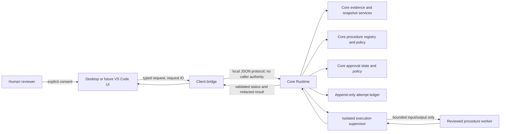

# Controlled Validation Execution Architecture

**M22.3.1 — implementation specification; documentation only.** The product owner approved the v1 trust model and strict boundary on **November 27, 2026** (decision recorded below). This document adds no protocol method, executable procedure, scheduler, authorization authority, or UI. M22.2.2 contracts and persistence are accepted foundations and remain unchanged. The existing [Controlled Validation design and persistence reference](controlled_validation.md) remains authoritative for the current contract and ledger details; this document specifies how a future implementation must extend those boundaries.

> **Approved v1 decision — Option A.** First-party interactive consent through VS Code or Desktop; Core remains authoritative for authorization, scope, single-use consumption, supervision, and result validation. Product explicitly accepts that Core cannot cryptographically determine that an approval request came from the official UI rather than another process running as the same OS user. Option B (a separate OS-level consent authority) is deferred. This decision does not enable execution and does not approve future capability expansion.

### Approved v1 restrictions

Offline procedures only; read-only operations only; a user-selected project and the exact approved target scope; OS-enforced process isolation and resource limits; no arbitrary shell or scripts; no unrestricted filesystem access; no procedure network access; no project modifications; no inherited provider credentials or unrelated secrets. AI may propose candidates but cannot approve, authorize, or execute. These are Core/supervisor-enforced invariants, not UI assurances. If enforcement is unavailable, the platform is disabled.

## 1. Current repository facts

### What exists

- `packages/core/src/validation/contracts.ts` validates bounded metadata and canonical preparation manifests. `ProcedureRegistry` is an in-memory map keyed by procedure ID and version; it rejects replacement of a version with different canonical metadata. Registry entries cannot claim a verified signature. The registry does not load, verify, or execute packages.
- Current procedure metadata already names a stable ID/version, package digest, publisher/signature identity, supported hypothesis/asset/evidence types, schema IDs, target/scope policy IDs, capabilities, resource ceilings, result schema ID, and retirement state. The only accepted network capability is `none`; filesystem capability is `none` or `read-only`. The referenced schemas and policy IDs are not resolved by this registry, so this is not yet a runnable typed procedure contract.
- `PreparationManifestV1` canonicalizes and binds the hypothesis content digest, snapshot ID/fingerprint, workspace identity, evidence IDs/digests, procedure ID/version/package digest/signature identity, target identity/scope, environment identity/policy digest, parameters, requested operations, and resource limits. Its canonicalizer has explicit depth, node, string, container, and total-byte bounds. The manifest is data only; it does not carry a trusted approval.
- `derivePhysicalWorkspaceIdentity` rejects a symlink workspace root and hashes its resolved physical path. This distinguishes many path aliases, but does not establish ownership or protect against a same-user process changing the workspace or its contents.
- `packages/core/src/validation/attemptLedger.ts` validates and stores bounded append-only hash-linked events, authorization facts, legal history, nonce/receipt uniqueness, and terminal outcomes under the existing workspace lock. It fails closed for malformed or ambiguous history. It does not verify authorization signatures, prove that a principal is genuine, launch work, or make a hash chain tamper-proof against a same-user rewrite.
- M22.3.2 adds a separate `ApprovalHistoryStore` for audit-only Option A approval events under a per-user Core data root, never under the selected project and never in `AttemptLedger`. The Core data root is `%APPDATA%/Aqiron/Aqiron Security/Core` on Windows, `~/Library/Application Support/Aqiron Security/Core` on macOS, and `$XDG_STATE_HOME/aqiron-security` or `~/.local/state/aqiron-security` on Linux. The log is `.aqiron-security/controlled-validation-approvals.log`; it is bounded to 4 MiB, 20,000 records and 8 KiB per event. Historical records omit nonce, raw arguments, monotonic deadlines, credentials and live authorization state. Startup never reconstructs the active approval map.
- The runtime protocol in `packages/core/src/runtime/protocol.ts` has hypothesis and AI methods but no Controlled Validation method. `CoreRuntime` has no procedure execution service. The public runtime composition deliberately does not expose its test-only AI executor seam.
- Hypothesis preparation derives evidence from completed scans retained by Core, uses Core-held scan provenance and `EvidenceEngine` observations, and rechecks source spans. AI preparation retains a short-lived Core record, binds it to a content fingerprint, revalidates before approval/execution, and is disabled for production synthesis by a fixed Core gate. These are useful freshness and one-use lifecycle patterns, but AI preparation approval is neither Controlled Validation authorization nor proof of a human identity.
- `CoreProcessManager` multiplexes request IDs over newline-delimited JSON and can send `core.cancel` while another request is pending. `CoreRuntime.handle` registers active requests and handles `core.cancel` synchronously; `runCoreRuntime` dispatches each request as a concurrent task. Cancellation sources notify listeners synchronously, but an acknowledgement means the request signal was delivered, not that external work or child processes have stopped.
- `packages/desktop/src/main.ts` accepts lines concurrently and tracks in-flight bridge tasks. `src-tauri/src/main.rs` is the actual Rust bridge in this checkout; `apps/desktop/` contains no Tauri source. Rust uses a mutex for the bridge slot, pending-response map, stdin writes, and active-synthesis token map. Those locks are held for bounded map/slot/write operations; `BridgeProcess::request` waits on its response channel without holding those mutexes. Tauri calls use `spawn_blocking`, and cancellation is a distinct request. The current cancellation-token routing is specific to hypothesis AI execution, not a general validation API.
- `src/desktopAdapter.ts` and `src/webview/` contain the current desktop presentation and hypothesis AI consent flow. No standalone VS Code extension entry point was found in the inspected source tree. Product approval of Controlled Validation Option A is separately recorded here; no consent implementation exists yet.

### Required changes before execution can exist

Execution requires new Core-owned runtime services and request/response types, protocol validation and dispatch, client wrappers, desktop bridge forwarding, user-facing preview/approval/status/result flows, a schema-resolving registry and signature verification policy, Core-owned Option A authorization, an isolated supervisor, a versioned atomic start-commit transaction, output validation/redaction, and lifecycle/cancellation tests on each supported OS. None is present today. These are future implementation items, not M22.3.1 changes.

## 2. Proposed trust boundaries and data flow

Core is the policy enforcement point and sole authority for preparation, evidence selection, target resolution, procedure compatibility, authorization verification, single-use start, execution supervision, result validation, and audit. Clients are untrusted request/display surfaces. The procedure worker is untrusted even when it is first-party: it receives only explicit inputs and capabilities. The workspace, source files, scan text, hypothesis prose, provider output, procedure output, and local audit files are data, not authority.

The intended sequence is: client requests a preparation using IDs and typed parameters; Core resolves workspace, target, procedure, evidence and scope and creates an immutable preview; the client renders the exact Core manifest and required disclosure; an explicit user gesture submits approval; Core records an Option A interactive-consent assertion and issues an ephemeral, one-use approval bound to the digest; the user separately starts the approved attempt; Core repeats all volatile checks and commits one-use consumption at the atomic start boundary; the supervisor runs the fixed procedure in an enforced boundary; Core validates bounded output and appends a terminal result. Any mismatch fails closed and requires fresh preparation and approval. The v1 approval assertion is not a cryptographically authenticated UI identity.

Core must never accept client-supplied evidence, target resolution, procedure bytes, identity claims, outcome, execution state, or timestamps as authoritative. Client-provided IDs and fingerprints are selectors only. Core derives or verifies all security-relevant values from retained state and current inputs.

## 3. Authorization model and v1 boundary

### Authority and approval binding

Core owns authorization state and decides whether an attempt may start. Under approved Option A, Core records an explicit interactive-consent assertion and owns the resulting in-memory single-use grant. There is no independent identity authority in v1. A click handler, webview message, Tauri argument, IPC peer PID, OS username, or request field is not a cryptographic identity assertion; Core cannot establish that the request came from the official UI.

Approval must bind to a canonical, versioned manifest containing at least:

- Core-derived physical project identity and project identity version.
- Hypothesis ID/content digest and evidence snapshot ID/fingerprint.
- Exact evidence references and content/provenance digests.
- Procedure ID/version, package digest, signer identity, and resolved input/result schema digests.
- Canonical target identity, allowed target set/scope, and scope policy digest.
- Canonical arguments and requested operation set.
- Runtime/sandbox image identity, policy digest, and every effective resource ceiling.
- Preparation/attempt ID, Core runtime epoch, nonce, issue time, expiry, and authorization policy version.

Core creates a unique approval ID and nonce bound to the manifest digest, records historical consent facts, and holds the usable grant only in memory. It revalidates evidence, target, registry version, policy, environment, expiry, and revocation immediately before start, and atomically consumes the grant exactly once. Approval for one target, project, procedure, argument set, evidence snapshot, or policy cannot authorize another. A changed value means a different manifest and requires new review. Concurrent starts have one winner; a duplicate start with the same attempt ID returns current state and never launches again. A conflicting reuse of an idempotency key is rejected.

An approval is never rehydrated as usable authority after Core restart or project identity/epoch change. Persisted ledger approval fields are historical evidence only. An unconsumed approval is invalidated on restart and requires new preparation and approval. An attempt whose start commit was durably recorded but whose worker state is lost becomes `INTERRUPTED`; it is never automatically retried. Use a monotonic clock for in-process expiry. Wall-clock time is retained for audit display, not treated as independently trusted proof. A detected backward wall-clock jump blocks new approval/start until the OS clock is corrected; it cannot extend a live approval because expiry is monotonic and epoch-bound.

The separate approval history is audit-only. Each issued event is durably appended before Core returns an approval. Revocation first invalidates the in-memory grant, then appends its event; if append fails, Core reports history unavailable and the grant remains invalid. Expiry similarly invalidates memory before recording. Shutdown appends invalidation events where possible. After a crash, an issued record with no terminal event is exposed as `historical-only`; it does not imply the grant remained active. A malformed, truncated, oversized, hash-chain-invalid log or pending append marker is unavailable and is never repaired, truncated, pruned, or replayed automatically. The operator must preserve the log and marker, stop Core processes using that data root, investigate the failure, and use the approved local incident process; ordinary operation cannot clear the marker or restore an approval. The unkeyed hash chain detects corruption/partial edits but does not resist a same-user rewrite of the entire log.

### Option A and Option B

| Choice | Security property | Cost and residual risk |
| --- | --- | --- |
| **Option A — first-party interactive consent (approved v1)** | Core prepares, validates, stores, and consumes a one-use grant; VS Code/Desktop shows exact scope and requires an explicit human action. It deters accidental/unattended execution and provides a review record. | **Accepted residual risk:** a malicious process running as the same OS user can call local Core directly, forge the approval request, or imitate the UI. Core cannot reliably distinguish the official client. The UI action is not cryptographically authenticated by Core. This does not defend against that same-user attacker. |
| **Option B — separate OS-level consent authority** | A protected broker independently authenticates the caller/user, displays the manifest digest/scope in a trusted surface, and returns a signed one-use receipt bound to a Core challenge. Core verifies it. This can resist ordinary same-user client impersonation when the broker is protected by OS identity/ACLs and signing keys are unavailable to that user process. | Requires a separately protected service, authenticated IPC, package identity verification, key lifecycle and revocation, trusted UI, recovery/update process, and platform-specific security review. It still cannot protect against administrator/root control, broker compromise, or a compromised logged-in session with equivalent broker access. Highest cost and platform variability. |

**Consent disclosure shown on every approval:** “This approval comes from an interactive VS Code/Desktop confirmation. Aqiron Core cannot cryptographically verify that this request originated from the official UI. Another process running as your OS user may call Core directly or imitate this flow. Approval is limited to the project, target, procedure, arguments, evidence, and limits shown here, for one run before the displayed expiry. Procedures are offline and read-only; they cannot modify the project or access the network. They receive no provider credentials or unrelated secrets. Procedure completion is not a vulnerability confirmation.” The disclosure must be adjacent to the explicit **Approve this one run** action and remain available in the audit view.

The manifest view must visibly show (not hide solely behind an advanced-details control) the canonical project root, exact target paths/ranges, procedure ID/version and verified artifact digest, purpose and limitations, human-readable arguments and argument digest, evidence snapshot/time/freshness/digest, effective read-only capabilities, no-network/no-project-write boundary, each resource ceiling, approval expiry, and expected output. Approval is disabled if any field cannot be rendered or understood.

### Approval contract

The canonical approval digest covers the full preparation manifest and these exact values:

| Binding | Required representation |
| --- | --- |
| Project | Core-resolved canonical root plus stable physical identity; project identity version. Display the root; digest both values. A path string alone is insufficient. |
| Permitted targets | Normalized in-root target set and target-policy digest; exact file IDs/relative paths and line/range or object identity. The selected project root does not imply access to every project file. |
| Procedure | Namespaced procedure ID, immutable semantic version, verified artifact/package digest, signer identity/key ID, resolved input/result schema digests, and revocation-catalog version. |
| Arguments | Strict-schema-validated canonical argument value and digest. Display all semantically relevant values; do not let the UI substitute a digest for readable values. |
| Evidence | Snapshot ID/fingerprint, scan ID/time, each evidence ID/kind/content/provenance digest, and freshness result. Procedures without evidence still bind an explicit `not-applicable` marker and policy. |
| Capabilities and limits | Exact read-only capability set and handles/paths, no network, no writes, no child processes unless a reviewed procedure specifically requires a fixed helper, and effective CPU, memory, process, file/read-byte, output, and wall-time ceilings. |
| Approval identity | Unique authorization ID and 256-bit random nonce, creation time, expiry, Core runtime epoch, attempt ID, manifest digest, and `interactive-ui-option-a` method. An OS account/session label may be recorded for context, but **is not authenticated proof of the UI or person**. |

V1 uses a fixed maximum approval lifetime of **five minutes**, not caller-configurable; effective expiry is the earlier of preparation expiry and five minutes after Core records the approval. Core keeps the usable grant in memory and the monotonic deadline in the active runtime. It persists audit facts, not a reusable bearer credential. The nonce is consumed once by the atomic start record. Identical approval retries may return the same recorded authorization only for the same attempt, manifest and UI request idempotency key; different content under that key is a conflict. Simultaneous consumption has exactly one winner. Replay, stale evidence, altered arguments, project/target substitution, expired/revoked procedure, mismatched epoch or policy, and invalid/used nonce all block start. Restart invalidates all unconsumed approvals.

### Procedure signature and revocation policy

Each v1 procedure is shipped in the signed Aqiron release/catalog; no runtime download or network lookup is allowed. Core verifies the artifact digest and a procedure-signing key chained to a product-pinned trust root, verifies the exact schemas/policy, and records key/catalog versions. Release engineering publishes a signed monotonic catalog and revocation list with Core updates. Core rejects an invalid signature, digest mismatch, revoked key/package, catalog rollback, or catalog older than the compiled minimum. Revocation delivered by a later signed offline update blocks all not-yet-started approvals; a running worker receives cancellation, but already completed effects cannot be undone. Key rotation/recovery and rollback tests are release prerequisites. The present code has no signature verifier; these checks are required future implementation.

## 4. Core-owned bounded procedure registry

The registry is an immutable catalog, not a caller-selected executable path. Each entry has a stable namespaced ID and semantic version; content/package digest; signer identity and verified signature state; build provenance; supported hypothesis/asset/evidence kinds; strict input and result schema IDs plus schema digests; target and scope policy IDs/digests; declared capability set; environment/sandbox identity; timeout, memory, CPU, process/thread, file-descriptor, read-byte, output-byte, and wall-clock ceilings; cancellation contract; audit field requirements; retirement/revocation state; and documented failure categories.

Core resolves schema and policy references during registration and refuses missing or mismatched references. A version is immutable: new bytes require a new version. Retirement prevents new preparations; revocation, signer failure, digest mismatch, or incompatible environment blocks all not-yet-started attempts, including previously approved ones. A procedure definition is separately reviewed and signed; metadata supplied by a client cannot register or activate it.

V1 should expose only fixed, reviewed operation adapters compiled into Core or a separately sandboxed worker image. Do not evaluate JavaScript/WASM supplied by a caller as a substitute for isolation. Prohibit arbitrary shell/PowerShell, scripts, subprocess commands from inputs, unrestricted filesystem APIs, unrestricted network, ambient credentials, writable workspace mounts, AI-generated executable instructions, and general scanner invocation. AI may suggest a candidate procedure/arguments as untrusted draft data; it cannot choose the final scope, approve, start, or modify the registry.

The current registry is metadata-only and in-memory. Its `signature.state` deliberately rejects `verified`; its schema ID fields are not resolved; and `target.allowedScope` is generic canonical JSON. Those contracts must evolve under reviewed versions before the catalog can authorize execution. Do not reinterpret existing fields as proof of verified publisher or enforceable sandbox policy.

## 5. Offline, read-only enforcement

The supervisor constructs a per-attempt immutable snapshot from the exact approved target before launch. Core opens paths relative to a retained project-root handle, rejects absolute/parent traversal and link/reparse traversal, checks physical containment and file identity, and compares identity/size/timestamps before and after bounded copy. A changed or unresolvable source fails closed. The worker sees only that private snapshot, mounted/shared read-only; it never receives the project root as a writable filesystem. Platform APIs must enforce read-only access below the language/runtime layer. No writable scratch directory is exposed to the procedure. Supervisor communication uses explicitly inherited bounded stdin/stdout pipes, not local network sockets.

Network denial must be enforced outside the procedure: no network device/namespace or deny-all network policy, no host/guest forwarding, DNS, proxy, or shared socket; deny IP and local socket creation/connect in the worker policy where supported. Test loopback IPv4/IPv6, UDP, DNS, raw sockets, inherited handles and attempted proxy access. A JavaScript API restriction or absence of a UI network option is not enforcement. Any unexpected network capability or policy setup failure prevents launch.

Project writes are denied at the mount/share/ACL boundary and independently by worker policy. The only result channel is the bounded supervisor pipe. No project writable mount, provider credential, credential helper, home directory, clipboard, host IPC, shell, arbitrary executable, or ambient environment is passed. Environment variables and file handles are allowlisted. The procedure's input is a frozen, digest-verified copy so source mutation during execution cannot change what it reads.

Resource ceilings are installed before launch by the OS supervisor: wall time from a monotonic timer, CPU budget/rate, memory/commit limit, process count fixed to the approved count, input/read-byte cap, output bytes/events, and queue/concurrency limits. Application timers are diagnostic backstops only. OS-denied syscalls, attempted write/network operations when observable, limit notifications, timeout, forced kill, and malformed/truncated output are mapped to audit failure categories. Missing telemetry is not reported as “no violation”; inability to establish the policy blocks execution.

## 6. Platform isolation candidates and release gate

These are implementation candidates, not supported-platform claims. All rows remain **UNSUPPORTED / EXECUTION DISABLED** until the mechanism is integrated, adversarially tested on the minimum supported OS edition/version, and reviewed. Feature/API presence alone is not acceptance.

| Platform | Candidate isolation stack | Filesystem / network | Processes, limits, cancellation | Main risks and required acceptance evidence |
| --- | --- | --- | --- | --- |
| Windows | Disposable Windows Sandbox backed by Hyper-V; disable vGPU, clipboard, audio, printer, and networking. Use a read-only mapped input snapshot. Add a Job Object inside the sandbox for active-process, CPU-rate/time, memory, and kill-on-job-close controls. Alternative AppContainer/LPAC is not the v1 default because its effective ACL/capability and host integration require a separate proof. | Map only the frozen target snapshot with `ReadOnly=true`; no project root or host home. Configure `<Networking>Disable</Networking>` and verify no NIC/route or localhost path. WSB memory cap plus Job limits. | Job Object groups descendants, sets process/time/memory/CPU limits and kill-on-close; the host supervisor must close/stop the entire disposable sandbox by a bounded deadline and observe termination. | Hypervisor/guest integration, shared-folder implementation, sandbox availability/edition, job breakaway, host OS vulnerabilities. Test write attempts and symlink/reparse escapes, child/job escape, process/memory/CPU exhaustion, IPv4/6/loopback/UDP/DNS, host clipboard/device absence, kill-on-close, crash/reboot cleanup, and measured stop bound. WSB configuration supports disabled networking, read-only mapped folders and memory sizing, but documents no per-job wall/CPU limit; those require the Job/supervisor design. [Microsoft Windows Sandbox configuration](https://learn.microsoft.com/en-us/windows/security/application-security/application-isolation/windows-sandbox/windows-sandbox-configure-using-wsb-file), [Windows Job Objects](https://learn.microsoft.com/en-us/windows/win32/procthread/job-objects). |
| Linux | Dedicated unprivileged helper in user, mount, PID and network namespaces; Landlock ruleset; `no_new_privs` + seccomp allowlist; cgroup v2. Require kernel features/configuration and delegated cgroup access, otherwise refuse. | Bind only immutable input snapshot read-only; make other host paths inaccessible; deny writes and path escapes through mount namespace/Landlock. Network namespace has no interfaces/routes; seccomp denies socket/connect families. No inherited host descriptors except bounded pipes. | cgroup v2 `memory.max`, `cpu.max`, `pids.max`; wall timeout in host supervisor; cgroup-wide kill and wait. Seccomp denies fork/clone/exec for the fixed no-child procedure. | Namespace/cgroup delegation varies by distro/container; seccomp is syscall filtering, not a filesystem sandbox. Landlock has documented limitations and must be layered. Test namespace creation failure, bind/`..`/symlink and proc-fd escapes, writes, all socket families, fork/clone, cgroup limits/OOM, cgroup kill, zombie cleanup, and hostile-kernel-feature fallback. [Linux Landlock](https://docs.kernel.org/userspace-api/landlock.html), [network namespaces](https://man7.org/linux/man-pages/man7/network_namespaces.7.html), [seccomp](https://man7.org/linux/man-pages/man2/seccomp.2.html), [cgroup v2](https://docs.kernel.org/admin-guide/cgroup-v2.html). |
| macOS | Disposable Linux guest in Apple Virtualization.framework (VZ); omit every network device, expose one read-only snapshot directory/disk, disable clipboard and unrelated devices. Host App Sandbox/entitlements constrain the VM manager but are not treated as guest procedure isolation on their own. | `VZSharedDirectory(readOnly: true)` or read-only disk for the frozen snapshot; do not share project root, home, sockets, or credentials. No network device in the VM configuration and guest firewall/namespace defense. | VZ CPU count and memory size cap guest resources; guest supervisor applies process/memory/CPU limits; host wall timer stops the VM and waits for stopped state, then discards it. | Virtualization entitlement/availability, virtio/shared-directory/hypervisor attack surface, guest-to-host boundary, VM stop behavior, and Mac model/OS coverage. Test absence of network device and all guest network paths, read-only share/disk writes, guest process escape, CPU/memory exhaustion, stop/force-stop bounds, VM crash, and host artifact cleanup on Intel and Apple silicon where supported. [Apple Virtualization framework](https://developer.apple.com/documentation/virtualization), [VM configuration](https://developer.apple.com/documentation/virtualization/vzvirtualmachineconfiguration), [read-only shared directories](https://developer.apple.com/documentation/virtualization/vzshareddirectory), [read-only disk attachment](https://developer.apple.com/documentation/virtualization/vzdiskimagestoragedeviceattachment). |

The release gate is per platform: all required controls above must be demonstrated with a signed build, automated negative tests, escape/resource/cancellation tests, supported-edition/version matrix, and independent security review. If any check is unsupported, skipped, inconclusive, or environment-blocked, that platform remains disabled. No “best effort” substitution is allowed.

## 7. Smallest initial procedure recommendation

**`source-span-integrity-check-v1`** is the first recommended procedure. It verifies one existing scanner/evidence source span has not changed since its Core-captured observation. It is an evidence-integrity check, not a vulnerability test and not proof that a finding is exploitable.

- **Target:** one Core-selected project and one exact file/range associated by Core with a retained completed-scan finding and `EvidenceEngine` observation. The user-selected project root and the exact target are both shown in the approval. No directory walk, arbitrary path, dependency resolution or network target.
- **Typed input:** observation ID, snapshot ID/fingerprint, scan/finding IDs, normalized relative file path, one-based inclusive start/end line, expected whole-file digest, expected span digest. Core resolves these from retained state; clients do not author them. Limits: one file, at most 10 MiB input, at most 4,096 lines in the approved range, strict UTF-8, bounded canonical input ≤32 KiB.
- **Operation:** Core captures an immutable input blob through safe handle-relative bounded read and freshness verification; the isolated fixed worker computes the specified whole-file and line-span digests and returns them. It performs no other file access and starts no child process.
- **Typed output:** `match | changed | unavailable | unsafe-target | invalid-encoding | limit-exceeded`, with snapshot/observation IDs, actual digests only when a complete safe read succeeds, byte/line counts, procedure and environment digests. No source excerpt or raw output.
- **Required evidence:** exact Core-retained scan record and provenance-linked current `EvidenceEngine` observation matching project, scan, finding, path, line range and both digests. Any missing/stale/ambiguous record blocks before approval/start.
- **Capabilities:** read-only access to the single frozen input blob; no project mount, writes, network, child process, secrets, or general filesystem capability.
- **Ceilings:** 10 MiB input, 32 KiB typed request, 8 KiB result, one worker process, 64 MiB worker memory, 1 CPU second and 2 seconds wall time. These values are hard caps; product may lower them by reviewed policy, never a client. Any OS that cannot enforce the relevant limits is disabled.
- **Failures:** stale/missing/ambiguous evidence, unsafe/raced path, non-regular file, invalid UTF-8, digest mismatch, input/output/CPU/memory/time ceiling, unavailable sandbox, setup failure, policy violation, worker crash, malformed result, audit commit failure. Return no positive validation; classify as `blocked`, `failed`, `interrupted`, or `inconclusive` per lifecycle.
- **Invariants:** one pre-bound file; immutable input; exact target containment; no project writes; no network/child process/secrets; bounded operation; no excerpts; output cannot mark a vulnerability confirmed.

## 8. Audit, retention and vulnerability review

Record procedure ID/version/artifact and signer/catalog digests; manifest, project, target, arguments, evidence, capabilities, limits and environment digests; Option A approval method and explicit `identity-not-cryptographically-verified` fact; approval ID/nonce/times/expiry/epoch; atomic consume/start record; request/execution IDs; state/stop/failure events; result schema and normalized output digest; violation/limit indicators; timestamps and provenance. Do not log credentials, full environment, source excerpts, or raw worker output.

V1 retains only the append-only attempt metadata and normalized bounded result summary under the project validation store until the user explicitly deletes Aqiron project data. No raw procedure output or source excerpt is retained by the procedure. There is no cloud sync or automatic export. A future delete/export feature must be explicit and explain that deleting local history removes its verification material. This local retention is not resistant to same-user deletion or full-chain rewrite. M22.2.2's hash chain detects accidental/partial corruption; it is not cryptographic tamper resistance against a same-user process. Stronger forensic audit requires a separately protected signing key or remote append-only anchor and is deferred.

Wall-clock UTC timestamps are audit metadata, not a trusted time authority. Live approval expiry is monotonic and limited to the active Core epoch. Core compares each new wall timestamp to the last committed timestamp; a detected rollback blocks new approvals/starts until corrected. Restart invalidates all pending authorization. A monotonic clock is not serialized as cross-restart proof.

Procedure authenticity is verified against product-pinned keys and a signed bundled catalog/revocation list. No online revocation is available in offline v1; urgent revocation requires a signed catalog/Core update, and implementations must enforce the minimum acceptable catalog sequence. The exact key ceremony, rotation and recovery procedures are release engineering prerequisites.

Only a human reviewer may confirm a vulnerability, through a separate review/promotion workflow. The reviewer must inspect current evidence, target and procedure provenance, environment/limit status, normalized output and uncertainty; establish affected component and security impact; and make an explicit attributed decision. Neither `completed`, `reproduced`, procedure exit status, nor AI proposal alone creates or confirms a `UnifiedFinding`. Ambiguous or incomplete evidence remains inconclusive.

## 9. Implementation sequence and prerequisites

1. **Approval and authorization:** implement exact manifest/display contract, every-approval same-user disclosure, Option A UI gesture, Core-generated nonce/IDs, five-minute monotonic expiry, epoch invalidation, scope/replay/revocation checks and audit assertion. Do not describe the local UI as authenticated.
2. **Atomic consumption and lifecycle persistence:** version a new transaction/record that atomically commits `START_COMMITTED` with consumed nonce/receipt and attempt identity under the workspace lock. Preserve M22.2.2 schema/behavior; add migration/version handling separately. Crash after commit becomes interrupted and cannot relaunch. Prove concurrent-start single winner and idempotency.
3. **Procedure registry and artifact verification:** resolve strict argument/result schemas and policy IDs, immutable artifact digests, release-pinned signatures, catalog sequence and offline revocation; test tamper, key rotation, rollback and revoked versions.
4. **OS isolation and supervisor:** implement the candidate stacks above with fail-closed feature probing, read-only snapshots, no network/secrets, quotas, violation capture, bounded spawn and confirmed termination. No platform is enabled before its acceptance matrix passes.
5. **Cancellation and bounded shutdown:** correlate UI request IDs to execution IDs; preserve independent bridge requests; cancel before/after start boundary; close all handles; kill complete worker/VM; report only confirmed local teardown; test disconnects, deadline and late results.
6. **Typed results and audit history:** validate output schema/digests, redaction, failure categories, normalized summaries and lifecycle events; provide explicit local history retention/deletion UX; preserve historical verification without reusing grants.
7. **Desktop and VS Code integration:** Desktop first through the existing Tauri/Node/Core chain. This checkout contains no standalone VS Code extension entry point, so identify/build that client seam before claiming parity. Both clients render identical Core manifests, disclosure and statuses. No CLI execution or AI authority.
8. **Cross-platform security acceptance:** adversarial isolation, scope, replay, clock, crash, cancellation, resource, secret-leak and result-integrity suites on every supported OS/edition/architecture; verify enforcement telemetry and cleanup; independent review; enable platforms individually only after evidence.

### Deferred future capabilities

Option B broker, network procedures, write-capable procedures, arbitrary or third-party executable packages, broad scanning/discovery, credentials, persistent host agents, CLI execution, AI authorization/execution, automatic vulnerability promotion, cloud audit and remote procedure updates are outside v1. None may be activated by configuration or inferred from this approval.

Core retains the authoritative attempt state; a dedicated supervisor owns process/job handles, deadlines, resource accounting, and teardown. Worker inputs are immutable bounded copies mounted/readable only as declared. The worker gets a minimal environment with no inherited secrets, home directory, credential helper, proxy, or general network. Output is capped during collection, decoded strictly, validated against the pinned result schema, and normalized/redacted before protocol or persistence. No partial/truncated output can satisfy a positive result.

Process-per-attempt is not sufficient isolation by itself. The chosen OS primitive must enforce filesystem, network, identity, process-tree, CPU/memory, and teardown limits. If the platform cannot establish required controls or confirm local teardown, execution is unavailable or terminally `REMOTE_STOP_UNCONFIRMED`/`INTERRUPTED`; it is never reported as a confirmed local cancellation. Platform policy and concrete sandbox technology remain unresolved.

Execution outcome and vulnerability conclusion are separate. `COMPLETED` says the procedure met its runtime contract and produced schema-valid output. `REPRODUCED` or `NOT_REPRODUCED` is an interpretation of the procedure's observation, not an automatic finding. A confirmed vulnerability requires a separate reviewer decision and validated evidence/promotion workflow; AI text, exit code zero, or successful procedure completion alone can never create a confirmed `UnifiedFinding`.

## 10. Client boundary and protocol evolution

Desktop and a future VS Code surface may request preparation, render Core's exact manifest in a human-readable summary plus expandable digests, explain target/risk/limits, and collect an explicit approve/deny gesture. Approval and start are distinct actions. UI should show current state, evidence freshness, expiry, procedure version, target scope, cancellation progress, and provenance. It must not locally infer authorization from a button click or hide an unknown/cancel-unconfirmed state. Both clients call the same typed Core contract and display the same Core result. Core revalidates after every user wait.

There is no Controlled Validation route in `CoreRuntime`, the protocol allowlist, `CoreClient`, `packages/desktop`, Rust's allowlist, or the desktop UI today. Any future protocol work needs typed strict schemas, compatibility/version policy, unknown-field rejection, bounded frames, request/execution correlation, and distinct authorization/cancel responses. This milestone does not specify a live operation name or add one. CLI execution is out of scope and remains unavailable. AI synthesis remains a separate closed-gate capability and is not a validation authority.

## 11. Architecture invariants and deferred decisions

The approved v1 product boundary is fixed. Remaining work is engineering qualification: implement the authorization contract, atomic-start schema, signature verifier/catalog, per-platform isolation candidates, resource/cancellation supervisor, UI disclosures, retention/deletion behavior, and acceptance evidence. No platform is supported yet. These are mandatory implementation prerequisites; they do not reopen the approved product decision.

## M22.3.3 lifecycle commitment boundary

The separate `ValidationLifecycleStore` implements a Core-only durable start commitment without a worker or executor. It stores per-approval append-only logs in 256 hash buckets under the per-user Core data root, with a cross-process lock per bucket and bounded per-bucket/per-approval capacities. The authorization service serializes revoke and commit operations for each approval, revalidates all bound facts, then relies on durable append as the single-use linearization point. Consumed state is applied in memory only after append succeeds. The receipt is explicitly non-executable, and no protocol/client operation exposes this method. See the lifecycle document for record schema, capacity limits, recovery, and at-most-once semantics.

This is at-most-once committed start, not exactly-once completion. A committed event is not evidence that a procedure launched or completed. No terminal lifecycle facts are emitted until an independently reviewed supervisor exists. A pending marker or any malformed history fails closed and requires manual recovery; the store never truncates or prunes committed history.

## References

- [Controlled Validation design and persistence](controlled_validation.md)
- [Controlled Validation threat model](controlled-validation-threat-model.md)
- [Controlled Validation lifecycle](controlled-validation-lifecycle.md)
- [Hypothesis Engine architecture audit](hypothesis-engine-design.md)
