# Controlled Validation Execution Lifecycle

**M22.3.1 — design only; Option A approved November 27, 2026.** The lifecycle below is a future contract, not a current Core protocol. Execution remains unavailable. Product accepts that Core cannot cryptographically distinguish official VS Code/Desktop consent from a request by another process running as the same OS user. Option B is deferred. V1 is offline, read-only, user-selected project scope, OS-isolated with enforced limits, with no shell/scripts, unrestricted filesystem/network, project writes, or inherited provider credentials/unrelated secrets. AI cannot authorize or execute.

## 1. Identity and immutable preparation

Core assigns a unique `executionId`/attempt ID and a fresh request ID for each client request. The execution ID is the durable identity of one proposed attempt; a request ID correlates one protocol call and its events/cancellation. They are distinct. Core stores the current authorization/worker handle in process memory and persists historical events in the per-workspace attempt ledger. Request IDs are not authorization tokens.

Preparation is derived inside Core from a retained hypothesis/evidence snapshot, current project identity, a Core-resolved procedure version and schemas, target policy, canonical arguments, runtime environment and limits. Core emits an immutable manifest and digest with expiry and preparation epoch. The client displays the exact reviewed scope. A field change produces a different digest and a new attempt. Evidence unavailable or stale, target resolution ambiguity, unknown procedure/schema, unsupported capability, or policy mismatch blocks preparation.

Preparation does not start work and does not imply consent. Approval is a separate explicit human action. A UI click does not authenticate the caller to Core under Option A.

## 2. Public lifecycle and internal substates

The requested public lifecycle is:

`PREPARED → APPROVED → QUEUED → RUNNING → COMPLETED / FAILED / CANCELLED / EXPIRED / BLOCKED`

The implementation needs more precise audit substates to represent authorization consumption and uncertain stop:

- `PREPARED`
- `APPROVAL_PENDING`
- `APPROVED` (a Core-recorded, in-memory, unconsumed and expiring Option A grant exists; it does not authenticate UI origin)
- `QUEUED`
- `START_COMMITTED` / `RUNNING`
- `CANCEL_REQUESTED`
- terminal `COMPLETED`, `FAILED`, `CANCELLED_LOCAL`, `REMOTE_STOP_UNCONFIRMED`, `EXPIRED`, `BLOCKED`, or `INTERRUPTED`

`CANCELLED` is exposed only when local teardown is confirmed; otherwise the client must display that stopping is unconfirmed. `EXPIRED` applies before execution start. Expiry after the start boundary is an authorization fact/audit event, not retroactive proof that a started attempt stopped.

```mermaid
stateDiagram-v2
  [*] --> PREPARED
  PREPARED --> APPROVAL_PENDING: manifest reviewed / request approval
  PREPARED --> BLOCKED: invalid scope, policy, evidence, or procedure
  PREPARED --> EXPIRED: preparation TTL elapsed
  APPROVAL_PENDING --> APPROVED: explicit Option A consent assertion recorded
  APPROVAL_PENDING --> BLOCKED: denied or approval binding rejected
  APPROVAL_PENDING --> EXPIRED: approval TTL elapsed
  APPROVED --> QUEUED: explicit start; preliminary checks pass
  APPROVED --> BLOCKED: revoked, stale, or policy changed
  APPROVED --> EXPIRED: approval expired
  QUEUED --> START_COMMITTED: atomic consume/start commit wins
  QUEUED --> BLOCKED: final validation fails or revocation wins
  QUEUED --> EXPIRED: TTL elapsed before start commit
  QUEUED --> CANCELLED_LOCAL: cancellation wins before start
  START_COMMITTED --> RUNNING: supervisor confirms worker started
  START_COMMITTED --> INTERRUPTED: crash or start outcome unknown
  RUNNING --> COMPLETED: bounded result validated and committed
  RUNNING --> FAILED: controlled runtime/schema failure
  RUNNING --> CANCEL_REQUESTED: cancel signal delivered
  CANCEL_REQUESTED --> CANCELLED_LOCAL: local teardown confirmed
  CANCEL_REQUESTED --> REMOTE_STOP_UNCONFIRMED: teardown cannot be confirmed
  CANCEL_REQUESTED --> COMPLETED: completion committed first
  CANCEL_REQUESTED --> FAILED: failure committed first
  COMPLETED --> [*]
  FAILED --> [*]
  CANCELLED_LOCAL --> [*]
  REMOTE_STOP_UNCONFIRMED --> [*]
  EXPIRED --> [*]
  BLOCKED --> [*]
  INTERRUPTED --> [*]
```

### Legal transition rules

| From | To | Guard |
| --- | --- | --- |
| `PREPARED` | `APPROVAL_PENDING` | Exact manifest remains current; user explicitly requests authorization. |
| `PREPARED` | `BLOCKED`, `EXPIRED` | Core rejects preconditions or preparation TTL passes. |
| `APPROVAL_PENDING` | `APPROVED` | Core records explicit Option A consent, bound to exact digest/nonce/expiry/epoch. This does not authenticate UI origin. |
| `APPROVAL_PENDING` | `BLOCKED`, `EXPIRED` | Denial, invalid binding, revocation or expiry; no worker starts. |
| `APPROVED` | `QUEUED` | Explicit start request; in-memory grant is still unused and current. |
| `APPROVED` | `BLOCKED`, `EXPIRED` | Freshness/scope/procedure/environment/expiry/revocation check fails. |
| `QUEUED` | `START_COMMITTED` | Atomic consume-and-start transaction succeeds exactly once. |
| `QUEUED` | `BLOCKED`, `EXPIRED`, `CANCELLED_LOCAL` | Failure, expiry, revocation, or cancellation wins before the boundary. |
| `START_COMMITTED` | `RUNNING` | Supervisor confirms launch for this attempt. |
| `START_COMMITTED` | `INTERRUPTED` | Crash leaves launch status uncertain. Never relaunch automatically. |
| `RUNNING` | `COMPLETED`, `FAILED` | A single terminal compare-and-set commits validated result or failure. |
| `RUNNING` | `CANCEL_REQUESTED` | Core records cancellation request and dispatches it to supervisor. |
| `CANCEL_REQUESTED` | `CANCELLED_LOCAL` | Supervisor confirms local process/job and local effects are quiescent under its contract. |
| `CANCEL_REQUESTED` | `REMOTE_STOP_UNCONFIRMED` | Local/remote completion cannot be established. Do not claim stopped. |
| `CANCEL_REQUESTED` | `COMPLETED`, `FAILED` | Completion/failure committed before cancellation terminal transition. Preserve the winner; never overwrite it. |

Terminal execution records cannot be rewritten. Later reviewer interpretation is a separate attributed append-only record. It may annotate evidence but cannot alter the execution event, outcome, or authorization history.

## 3. Atomic start, single-use grants and idempotency

The start linearization point must combine durable approval/nonce consumption with the transition that permits worker launch. The current M22.2.2 ledger expresses authorization and lifecycle facts as separate event families and appends one event at a time; it does **not** provide a multi-event transaction or a current runtime CAS/start operation. Do not claim that simply appending `consumed` and then `starting` is atomic. Preserve v1 ledger bytes/schema and append protocol; add a separately versioned v2 transaction log/checkpoint referencing the verified v1 terminal sequence and hash. Never rewrite v1 history.

The v2 log's single `start-committed` record is the transaction/linearization point. Under the workspace lock, Core rechecks epoch, in-memory unused approval, monotonic expiry, revocation, evidence freshness, project/target identity and manifest digests. It durably appends one bounded record containing execution ID, manifest digest, approval ID, hash of nonce, Core epoch, project/target digest, procedure artifact/schema/policy/environment digests, argument/evidence/capability/limit digests, start-request idempotency-key digest and audit timestamp. The record semantically consumes approval and commits `START_COMMITTED`; no separately acknowledged consume/start gap exists. Use the existing marker/append/fsync/directory-sync/marker-removal protocol for this single event. Launch only after full append acknowledgement. Ambiguous persistence fails closed and launches nothing. A crash after commit, including before spawn or confirmation, recovers as `INTERRUPTED`; never relaunch.

Use caller idempotency keys only to retry the same typed intent. Same key and same canonical binding returns the existing execution; conflicting content is rejected. Different keys cannot consume one approval: the workspace lock plus one append admits one winner. Pre-commit revocation that wins the lock/check prevents start; after commit it is recorded and requests stop but cannot undo work. Historical terminal records remain verifiable and never restore an approval.

Core startup establishes a fresh runtime epoch. On restart, preparations/approvals not yet consumed are unusable and require fresh preparation and consent. Previously committed running attempts become `INTERRUPTED` or a verified terminal history based on supervisor evidence; never infer success or rerun them. Historical terminal records remain queryable and verifiable, but are never authorization inputs.

## 4. Expiry, evidence freshness and revocation

Core checks approval expiry and procedure/target/evidence/policy freshness when accepting approval, when queueing, and immediately before the atomic start boundary. The final check and consume/start commit must be serialized so that revocation-before-start and start cannot both win. If revocation wins before commit, record `BLOCKED` and launch nothing.

After `START_COMMITTED`, revocation cannot erase the start. It records a revoke/stop request and invokes supervisor cancellation. Running side effects may already have happened; the resulting record is completed, failed, cancelled-local, remote-stop-unconfirmed, or interrupted according to observed facts. Expired/revoked grants are never usable for another attempt. A fresh evidence snapshot or any changed manifest requires a new approval.

There is no external consent authority or trusted external clock in v1. Core uses a monotonic in-process deadline for the fixed five-minute approval lifetime; wall timestamps are audit metadata. Core epoch invalidates unconsumed approvals on restart. Detect wall-clock rollback against the latest verified ledger timestamp and block new approvals/starts until corrected; never restore monotonic deadlines. Verify procedure revocation against a locally available signed catalog pinned to a release key and monotonic sequence. Invalid signatures, unknown keys, rollback or missing required catalog fail closed; no network lookup is made. Revocation after start requests stop but cannot erase history or prove reversal. M22.2.2's unkeyed hash chain detects partial/corrupt edits, not a same-user rewrite of all history. Retain bounded normalized results/provenance until explicit Aqiron project-data deletion; raw output is not retained by default. Stronger tamper evidence requires a future protected key or remote anchor. Only a human reviewer may confirm a vulnerability through a separate attributed action; execution success never confirms one.

## 5. Cancellation and bridge concurrency

### Existing path and gap

Today, `CoreProcessManager` supports concurrent pending requests and writes an independent `core.cancel` frame. `runCoreRuntime` launches request handlers concurrently, so cancellation can reach an active request while another awaits. `CoreRuntime.cancelRequest` synchronously signals a cancellation source and invokes its registered callback. In the Rust bridge, `core_request` uses `spawn_blocking`; map and stdin mutexes are not held while waiting for a response. The current implementation has a narrow hypothesis-AI cancellation token map and best-effort process kill paths, not a validation supervisor.

Therefore the inspected Tauri bridge does **not** currently hold its shared bridge-slot or pending-map mutex across the Core response wait. The design should preserve this short-lock/concurrent-request property. It must not add a global mutex around an in-flight operation. Cancellation and execution each need independent request IDs, with one stable execution ID linking state/events. A cancel request must be accepted concurrently even when the start request is blocked.

### Required future propagation

1. UI stores the active execution ID and the request ID for its in-flight start/status request.
2. Desktop bridge forwards cancellation in a distinct request without waiting on the start future or acquiring a lock held by that future.
3. Rust bridge allocates a new bridge request ID for cancel, writes under a short-lived stdin mutex, then waits on its own response channel. The pending-response map lock is held only to insert/remove.
4. Node Desktop bridge dispatches start and cancel concurrently through the same `CoreClient`/`CoreProcessManager`; correlated events carry execution and request IDs.
5. Core validates the cancel target, records `CANCEL_REQUESTED`, and signals the supervisor. A positive cancel acknowledgement means the signal reached the relevant supervisor operation, not that shutdown is complete.
6. Supervisor terminates the complete local job/process tree using an OS-supported mechanism, closes handles/streams, waits to a bounded deadline, and reports confirmed teardown or uncertainty. Core then commits a terminal state once.

The UI displays “cancellation requested” until terminal confirmation. If the bridge or Core disconnects, report unknown/interrupted; do not display cancelled. A stale cancellation ID cannot target a newer attempt. Late output is quarantined and cannot overwrite the terminal state.

### Cancellation race outcomes

- Cancel before `START_COMMITTED`: cancellation wins under the same per-attempt transaction and the worker never launches.
- Cancel after `START_COMMITTED` but before worker confirmation: request supervisor stop; if launch state cannot be resolved by deadline, `INTERRUPTED` or `REMOTE_STOP_UNCONFIRMED`.
- Cancel while running: first terminal compare-and-set wins. Confirmed local teardown yields `CANCELLED_LOCAL`; otherwise stop is unconfirmed.
- Completion already committed: cancel returns terminal status and does not rewrite it.
- Worker failure/crash and cancellation overlap: preserve one terminal lifecycle plus a separate cancellation-attempt fact; don't synthesize success.

### Cleanup and bounded shutdown

Every exit path closes streams, timers, process/job handles, temporary files and per-attempt locks. Supervisor shutdown stops admission, requests cancellation for active jobs, waits within a fixed deadline, commits confirmed/uncertain outcomes, then exits. The desktop bridge drains/rejects pending requests and stops Core within a separate bound. Current `CoreProcessManager.stop()` sends shutdown then calls `child.kill()` without waiting for process-tree confirmation; Rust `BridgeProcess::drop` waits up to two seconds for the bridge child, then kills/waits that child only. Neither proves descendants stopped. Future execution requires a job/process-group/container/VM lifecycle that the OS can account for and explicit timeout outcomes.

## 6. Audit record model

Use immutable versioned records linked to an `executionId` and chained by sequence/hash:

- Procedure ID/version, content digest, signer verification reference, schema/policy/environment digests.
- Preparation manifest/digest, project identity, hypothesis content digest, evidence snapshot and evidence IDs/content/provenance digests.
- Target identity and scope, canonical argument digest (and minimum necessary typed values), requested capabilities and effective resource limits.
- Option A interactive-consent assertion, approval ID, manifest binding, consent time, expiry, nonce hash, runtime epoch and validation result. Do not record or imply a verified UI principal.
- Authorization consume/start commit, queue/start/completion/cancel/failure/expiry/revocation events, request IDs, execution ID, timestamps and ordering facts.
- Supervisor/environment identity, worker exit category, resource accounting, output length/digest, schema version, redaction/truncation indicators, normalized typed findings, and provenance pointers.
- Reviewer interpretation and any separate finding-promotion decision, actor/authority, time, rationale, and evidence links.

Raw output is optional, separately protected, bounded, redacted and governed by retention/access/export/deletion policy. The safe protocol result is an allowlisted summary. The attempt ledger is append-only at the application layer and tamper-evident against partial edits; without protected keys/remote anchoring it is not tamper-proof against a same-user writer. Retain enough digests and provenance for historical verification after approval expiry, while never accepting historical records as a new grant.

## 7. Outcome vocabulary and failure mapping

Keep execution lifecycle separate from `ResultOutcome` and from vulnerability status:

| Lifecycle/result | Meaning |
| --- | --- |
| `COMPLETED` + `reproduced` | Procedure completed under its declared contract and observed the expected signal; reviewer interpretation still required. |
| `COMPLETED` + `not-reproduced` | Valid completed procedure did not observe the signal; this is not proof the issue is absent or safe. |
| Terminal + `inconclusive` | Data/output incomplete, conflicting, stale, uncertain, or unable to support a conclusion. |
| `BLOCKED` + `blocked` | Policy, authorization, target, prerequisite or platform prevented start. |
| `FAILED`/`INTERRUPTED` + `environment-error` | Setup/runtime or crash prevented a valid procedure result. |
| `CANCELLED_LOCAL` | Local supervisor teardown was confirmed; says nothing about reversing prior effects. |
| `REMOTE_STOP_UNCONFIRMED` | Stop could not be established; never relabel as cancelled. |

Malformed/oversized output, timeout, unsupported schema, unavailable isolation, failed audit commit, ambiguous spawn, and unknown exit code cannot produce `reproduced` or `not-reproduced`. A successful process exit is not a confirmed security vulnerability. A later reviewer may link a confirmed finding only through a separate validated promotion policy; execution never performs automatic promotion.

## 8. Current persistence mapping and change boundary

M22.2.2's ledger already validates states such as `prepared`, `awaiting-authorization`, `authorized`, `queued`, `starting`, `running`, cancellation states, `completed`, `failed`, `expired`, and `interrupted`, with a separate authorization family and outcome validation. It uses durable append, a recovery marker, the workspace lock, and fail-closed integrity checks. This is a persistence foundation, not a running coordinator.

Its current separate append calls do not establish the atomic multi-fact start linearization required above, nor does the in-memory `ProcedureRegistry` provide verified authorization or restart recovery. The separately versioned v2 log/transaction design above is required; do not alter accepted M22.2.2 behavior in this architecture milestone. Historical results remain verifiable through hash-chain and schema/history checks after approval expiry; they never restore usable authorization.

### Audit-only approval history (M22.3.2)

Core stores approval audit events in its separate per-user data root, not the selected project and not `AttemptLedger`: Windows `%APPDATA%/Aqiron/Aqiron Security/Core`, macOS `~/Library/Application Support/Aqiron Security/Core`, Linux `$XDG_STATE_HOME/aqiron-security` or `~/.local/state/aqiron-security`. The bounded log is `.aqiron-security/controlled-validation-approvals.log` (4 MiB, 20,000 events, 8 KiB per event). Version 1 records use a sequence and SHA-256 hash chain and support `approval-issued`, `approval-revoked`, `approval-expired`, and `approval-invalidated`. Issue facts include project identity and permitted-scope digest, procedure/version/artifact, argument digest, evidence identity/digest, capabilities, limits, request identity/digest, and timestamps. It deliberately omits raw arguments, nonce, monotonic deadline, credential data, and any live validity flag. These unkeyed hashes are integrity checks, not tamper resistance against the same-user attacker.

Core durably appends `approval-issued` before returning success. If storage is unavailable, malformed, over capacity, or an append is ambiguous, no grant is returned. Revocation and expiry invalidate the in-memory grant before attempting their audit append; an append failure is reported and never reactivates the grant. Orderly shutdown records invalidation when possible. On restart the active map is empty; history inspection reconstructs only `HistoricalApprovalRecordV1` values with `historicalOnly: true` and `canAuthorizeExecution: false`. Unfinished issue events are `historical-only`, including after a crash. Duplicate request IDs and approval IDs are rejected against history.

Rejected malformed or unauthorized requests are not persisted: they are caller-controlled and could otherwise exhaust the bounded durable log. The Core response carries the typed rejection; durable audit begins with a valid, fully bound approval issue.

Corrupt UTF-8, malformed records, invalid sequence/hash, oversized history, or a pending append marker makes history unavailable. Recovery preserves original bytes and marker, never truncates, rewrites, silently prunes, or restores a grant. An operator must stop Core processes for that per-user data root, preserve the log and marker, investigate the failure, and follow the local incident procedure; no automatic or client-facing repair API exists. Capacity exhaustion rejects new approval creation without deleting older events.

### Atomic start commitment (M22.3.3)

`ValidationLifecycleStore` is a separate Core-owned journal below the Core user data root. It does not reuse `AttemptLedger` or `ApprovalHistoryStore`. The initial implementation persists only `execution-start-committed`; the versioned schema also reserves the terminal categories `execution-completed`, `execution-failed`, `execution-cancelled`, `execution-expired`, `execution-blocked`, and `execution-interrupted`. No current code writes terminal events because there is no executor in this milestone.

Each approval is assigned to one of 256 SHA-256 buckets. A bucket has its own cross-process filesystem lock and append-only event files partitioned by approval ID. This serializes competing commits for one approval and avoids a single global lifecycle lock. Each bucket is limited to 4 MiB and 20,000 approvals; each approval file is limited to 64 KiB and 128 events. There is no pruning. Lock acquisition uses the existing bounded `withWorkspaceLock` protocol (15 seconds), including conservative stale-owner recovery. Per-process approval mutation is serialized by approval ID with a 15-second bound. A timeout rejects without granting or launching work.

For `commitStart`, a timeout acquiring the in-process approval lock is returned as the existing typed `START_COMMIT_UNAVAILABLE` result. The dedicated lock-timeout condition is translated at the operation boundary; unrelated programming errors are not blanket-converted. Since the timed-out call never enters the locked transaction, it does not call the lifecycle store, append a start event, consume the in-memory approval, or return a receipt. Its queue node is released, the lock owner can complete normally, and a later valid attempt is evaluated under the same authorization checks. A lock timeout is not a committed start and does not alter the at-most-once durable append linearization point.

The start event schema version 1 binds a unique event and execution ID, approval ID, approval-history issue-event ID/hash, authorization binding digest, canonical project root and identity, permitted targets, procedure ID/version/artifact digest, argument digest, evidence snapshot ID/digest, restricted capabilities, resource limits, timestamp, sequence, and prior/current event hashes. It contains no nonce, raw arguments, credentials, monotonic deadline, or live authorization object. Returned receipts are typed `ConsumedControlledValidationAuthorizationV1` values with `nonExecutable: true`; historical records have `historicalOnly: true` and `canAuthorizeExecution: false`.

The Core operation takes the active approval ID, the expected digest of its exact authorization binding, and the original request to revalidate. It checks active in-memory state, expiry, revocation, and all project/procedure/argument/evidence/policy bindings while holding the approval-local mutation lock. It then acquires the bucket's cross-process lock, validates the complete bucket, rejects any prior record for the approval, and durably writes a pending marker plus the bounded start event. The durable event append is the single-use commitment point. Only after append success does Core mark the active grant consumed and return the non-executable receipt. A duplicate sees the existing start and receives an already-consumed response; it cannot add another event. Revocation and start commitment take the same in-process approval lock, so whichever obtains it first defines the order. Expiry is checked under that lock immediately before commit.

If Core crashes before the start append, the in-memory grant disappears at restart and cannot be retried. If it crashes after durable append, the approval remains permanently committed. A pending marker, torn line, malformed record, broken chain, duplicate/reordered event, symlink, unsafe file, or capacity breach fails closed and is not repaired or pruned. An ambiguous append produces no receipt and leaves the active in-memory approval unconsumed, but the persisted pending marker blocks subsequent commits and requires manual recovery; restart also invalidates the approval. A committed start with no later outcome means only that the commitment was durable: it does not prove worker launch, procedure execution, or completion. The guarantee is at-most-once committed start, not exactly-once completion.

The production Node adapter supports these durable lifecycle operations only where it can use real POSIX file and directory synchronization. It opens new files exclusively without following symlinks, writes and synchronizes file contents, synchronizes the containing directory when an entry is created or removed, and synchronizes appended data before acknowledgement. Lifecycle ordering durably creates the recovery marker, appends the start record, then removes the marker. A focused integration test uses the real adapter for both approval history and start commitment, then reopens and validates the stored record and hash chain. Run it on Linux/macOS with `npm run core:build`, `npm run test:compile`, and `npx mocha --ui tdd .ci-compiled-tests/src/test/controlledValidationLifecycle.test.js --grep "real Node filesystem durably commits and reopens a complete POSIX start lifecycle"`. The existing `.github/workflows/cross-platform.yml` Linux/macOS matrix runs the lifecycle suite through `npm run test:focused`. Successful `fsync`/directory `sync` calls establish that the OS/filesystem accepted those synchronization requests; they are not proof of survival through sudden power loss, controller/device cache failure, or broken filesystem/hardware guarantees. Windows remains fail-closed because this adapter cannot establish the required directory-entry durability there. The integration test is skipped on Windows and must pass on Linux/macOS CI before POSIX verification is considered complete.

This operation is internal to Core and is not registered as a protocol operation or client-facing execution endpoint. No worker launch function is connected to the receipt. A future executor must separately design launch/recovery and terminal result persistence before execution can be enabled.

## References

- [Execution architecture](controlled-validation-architecture.md)
- [Threat model](controlled-validation-threat-model.md)
- [Current contracts and persistence](controlled_validation.md)
