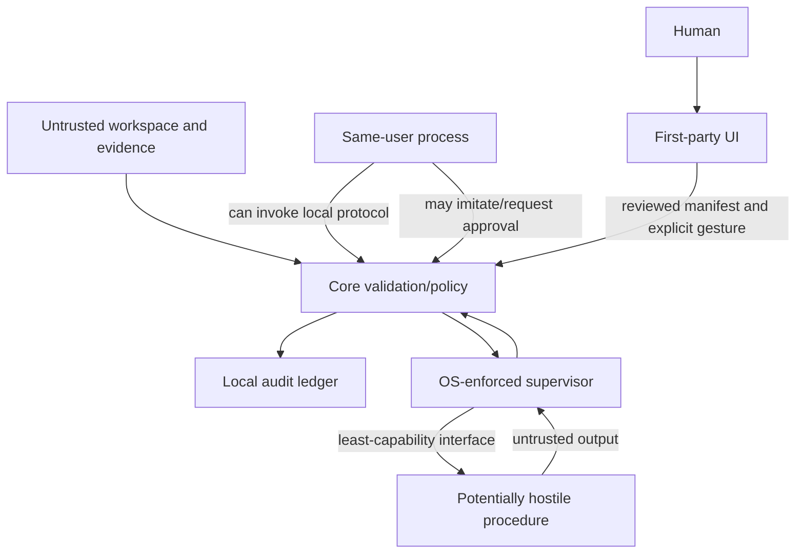

# Controlled Validation Execution Threat Model

**M22.3.1 — design only; decision approved November 27, 2026.** No execution capability is implemented or enabled. Product approved Option A for v1 and explicitly accepted the same-user local-caller limitation. Option B is deferred. The v1 boundary is offline, read-only, user-selected project scope, OS-enforced isolation and resource limits, no arbitrary shell/scripts, no unrestricted filesystem, no network, no project writes, no inherited provider credentials/unrelated secrets; AI can propose candidates only. These controls are prerequisites, not current guarantees.

## 1. Scope and security assumptions

The system accepts a proposed investigation of project evidence, asks a human to review a bounded immutable preparation, authorizes a single attempt, runs a fixed reviewed procedure under enforced limits, validates its output, and records provenance. It does not establish that every hypothesis is true, that every scanner result is correct, or that a completed procedure proves a vulnerability.

Assume attackers can control workspace contents and metadata; place prompt-injection strings in source, docs, dependencies, findings, and AI output; issue malformed, replayed, concurrent, or forged local protocol requests; run another process as the same OS user; race file/target changes; provide malicious or compromised procedure output; exploit parser/resource limits; interrupt Core or the supervisor; and modify same-user-writable audit files. A compromised Core process, kernel, administrator/root account, or selected consent broker invalidates the guarantees that depend on it. State residuals explicitly.

## 2. Assets and trust boundaries

### Assets

- Human intent, project/target scope, one-use authorization and revocation state.
- Procedure package identity, schemas, policy, environment and capability grants.
- Evidence snapshot, source provenance and freshness.
- Workspace, host files, secrets, process availability and network boundary.
- Execution output, derived observations, audit history and reviewer interpretation.
- Correct UI representation of target, procedure, arguments, limits and uncertainty.

### Boundaries

1. **Workspace to Core:** all files, findings, hypothesis prose, source text, RAG chunks and scan metadata are untrusted input. Core path/freshness checks reduce accidental stale/unsafe use but cannot treat same-user-writable project data as an independent trust anchor.
2. **Client to Core:** JSON-line requests, IDs, Tauri arguments, webview messages, local caller identity, and UI state are untrusted. Local IPC and a username/PID field do not authenticate the official product UI.
3. **Human/UI to Core:** Option A records an explicit interactive-consent assertion. Core owns the one-use grant and all policy checks, but cannot cryptographically establish that the request came from the official UI rather than another process running as the same OS user. No stronger caller authentication is claimed.
4. **Core/supervisor to procedure:** procedures are potentially hostile and receive only a narrow capability. A process boundary without OS-enforced confinement is not a sandbox.
5. **Runtime to storage:** the existing M22 ledger provides bounded append-only validation and hash-chain consistency. A same-user attacker who can rewrite the whole local history can recompute an unkeyed chain; it is not non-repudiation.
6. **Client bridge to OS process:** request/cancel multiplexing and child teardown rely on the bridge/supervisor implementation and platform process controls. Existing `kill()` paths are best effort and are not proof that descendants or external work stopped.

## 3. Authorization choices and explicit residual risk

### Option A — interactive first-party UI

The UI renders a Core-created manifest and requires explicit human action. Core independently validates manifest binding, current evidence, target, procedure, expiry, and one-time use. This provides user-intent friction and prevents accidental background starts. It does **not** prove to Core that approval came from the official UI. A same-user process may call the local Core protocol, imitate the client, or send the same approval request. Do not label a UI event, Tauri call, local account name, or IPC PID a cryptographically authenticated principal.

Product approved Option A for Controlled Validation v1 on November 27, 2026, including this residual risk. Every approval must display adjacent to the approval action: “This approval comes from an interactive VS Code/Desktop confirmation. Aqiron Core cannot cryptographically verify that this request originated from the official UI. Another process running as your OS user may call Core directly or imitate this flow. Approval is limited to the project, target, procedure, arguments, evidence, and limits shown here, for one run before the displayed expiry. Procedures are offline and read-only; they cannot modify the project or access the network. They receive no provider credentials or unrelated secrets. Procedure completion is not a vulnerability confirmation.” This disclosure is not a mitigation against a malicious same-user process.

### Option B — separate OS-level consent authority

A protected service/broker uses OS-authenticated IPC, verifies signed client/package identity, renders the exact approved target/procedure/arguments/digest in a trusted surface, and signs a nonce-bound, short-lived one-use receipt. Core verifies receipt and policy before recording/consuming it. Broker keys must be protected from ordinary same-user processes; keys, updates, revocation, recovery, UI spoofing, and service ACLs need independent review.

This reduces caller impersonation by ordinary same-user processes but does not withstand administrator/root compromise, broker compromise, equivalent privileged access, or all session compromise. It materially increases engineering, signing, OS integration, lifecycle, and platform-qualification cost. Choose it if product requires same-user resistance; until then, keep execution disabled.

Regardless of option, authorization is not portable across Core restarts, project identity changes, changed evidence/scope/procedure/arguments/environment, or policy revisions. Persisted approval facts are audit evidence, not a reusable bearer token. Revocation before start prevents execution; after the start boundary it requests stop but cannot undo work or prove effects were reversed.

## 4. Principal attack scenarios

| Attack | Failure mode | Required controls and residuals |
| --- | --- | --- |
| Same-user forged approval | Local caller sends approve/start without the visible user flow. | Accepted Option A residual for v1. Core still enforces exact scope, freshness, expiry, nonce, and single-use state; these do not authenticate UI origin. Option B is deferred. |
| Prompt injection through source/AI output | Procedure choice, target, or arguments are steered by malicious prose. | Treat all prose as data; fixed allowlisted procedure IDs; Core validation and human review of exact typed manifest; AI cannot authorize or execute. |
| Scope substitution / confused deputy | A client changes project, target, operation, or arguments after review. | Core-derived canonical scope, digest binding of every field, exact revalidation before start, no client-supplied target/evidence/result authority. Any change requires new preparation. |
| Path, symlink, reparse-point or TOCTOU race | Reviewed artifact points elsewhere at execution. | Physical identity and handle-based no-follow open; strict containment; freeze/copy exact artifact; revalidate file identity/content immediately before use. Same-user writers can still race without suitable OS handles/immutability. |
| Stale or ambiguous evidence | Old scan/source span is used to authorize a current run. | Retained Core snapshot, exact evidence and digest binding, source freshness recheck before start, reject unavailable/ambiguous evidence, no inherited consent after refresh. |
| Procedure replacement, signer compromise or policy drift | Approved code/schema is no longer the artifact that runs. | Immutable ID/version/content digest, verified signer and pinned schemas/policy/environment, revocation check before consume, new version and reapproval for changes. A signature verifier is not implemented. |
| Replay, duplicate start, concurrent start | One approval launches multiple runs or survives restart. | Attempt ID, nonce, runtime epoch, expiry, v2 durable atomic consume/start record, idempotency key conflict detection. Restart never restores authority. Current ledger has no atomic multi-fact start event; the v2 design is specified in the lifecycle document and must be implemented before execution. |
| Malicious procedure escape | Worker reads secrets, writes host files, launches children, or reaches network. | OS-enforced least privilege, no ambient credentials, deny-by-default filesystem/network, process-tree/job control, resource quotas and adversarial per-OS testing. Without enforceable isolation, do not run. |
| Malformed/hostile result | Procedure fabricates a finding, emits secrets, or exploits parsers. | Byte caps during collection, strict schema and encoding, redaction/allowlisting, result provenance, isolate parser, classify truncation/malformed output as inconclusive/environment failure. Execution success is never a confirmed vulnerability. |
| Cancellation/shutdown race | User sees “cancelled” while worker continues or late result overwrites terminal state. | Independent request IDs, cancellation reaches supervisor, acknowledgement means signal delivered only, terminal CAS, confirmed local teardown before `CANCELLED_LOCAL`; otherwise remote-stop-unconfirmed/interrupted. Quarantine late output. |
| Resource exhaustion | Infinite loops, fork bombs, output floods or lock abuse. | OS-enforced CPU/memory/process/FD/disk/output ceilings, bounded queue and concurrency, timeouts on monotonic clock, per-project/global admission control, quotas and cleanup. JS timers alone are not hard limits. |
| Audit rewrite or rollback | Same-user attacker edits attempt or approval history or rolls time back to replay consent. | Append-only writers, sequence/hash links, bounded per-user approval history, protected signing key/remote anchor for stronger tamper evidence, monotonic in-process TTL and rollback detection, nonce uniqueness. Local unkeyed chains detect partial edits only and can be rewritten by the same-user attacker. |
| Secret leakage | Worker inherits environment, logs, prompts, result, or artifact contain credentials. | No credential injection, minimal environment, bounded redaction, safe structured diagnostics, separate restricted artifacts with retention/access policy. Do not promise complete redaction. |

## 5. Security invariants

1. Core is the sole application-level authorization and execution decision point.
2. Authorization covers exactly one immutable project, target, procedure version/digest, argument set, evidence snapshot, environment/policy, resource budget, attempt ID, nonce and expiry.
3. No request starts without verified current authorization; no nonce/attempt starts twice.
4. New Core epoch, changed identity/scope/evidence/arguments/procedure/policy, expiry or revocation invalidates unconsumed approval.
5. No arbitrary shell, user script, unrestricted filesystem/network, inherited secret, AI-generated executable instruction, or CLI execution path exists.
6. Worker output is untrusted until bounded, parsed, schema-validated, provenance-bound and durably recorded.
7. “Completed”, “reproduced”, reviewer interpretation, hypothesis status, and confirmed vulnerability are distinct facts. No execution outcome automatically promotes a finding.
8. Cancellation is reported as complete only after the relevant local supervisor confirms teardown. Remote side effects may remain uncertain.
9. Ambiguous persistence, time, authorization, process, isolation, or result state fails closed and cannot auto-retry.
10. The supported-platform list includes only systems with tested enforcement and cleanup guarantees.

## 6. Failure and residual-risk policy

Missing/invalid signer catalog, stale evidence, target drift, policy/schema mismatch, revoked procedure, duplicate/expired approval, unsupported platform, unavailable sandbox, clock uncertainty, lock/disk/durability failure, output truncation, worker crash, ambiguous cancellation, and audit integrity errors block or terminate the attempt. Preserve prior ledger bytes, do not invent success, do not auto-repair authoritative history, and do not retry an ambiguous start. Classify the result as `BLOCKED`, `EXPIRED`, `FAILED`, `INTERRUPTED`, `INCONCLUSIVE`, or `REMOTE_STOP_UNCONFIRMED` as appropriate.

## 7. Approved decision and engineering prerequisites

- Product decision: closed for v1 by approval of Option A and the strict offline/read-only boundary on 2026-11-27. No broader capability is authorized.
- First procedure and exact typed target/input/output contract.
- Supported OS and sandbox primitive with tested filesystem/network/process/resource guarantees.
- Monotonic TTL, wall-clock rollback detection and operator recovery policy (no external human identity assertion is claimed in Option A).
- Procedure signing, review, distribution, revocation and emergency response.
- Audit/artifact retention, encryption, access/export/deletion and tamper anchor.
- Evidence and reviewer standard for any later confirmed-vulnerability promotion.

Procedure signing and revocation policy; per-platform isolation qualification; clock policy; audit/result retention and tamper evidence; and human evidence-review criteria remain engineering prerequisites. Until these controls are implemented and tested, execution remains unavailable on every platform. Product acceptance of Option A does not assert that its residual risk has been technically eliminated.

## Lifecycle commitment risks (M22.3.3)

Start commitment is guarded by both an approval-local in-process lock and a bounded cross-process filesystem lock assigned by approval hash bucket. This prevents concurrent local callers and independent Core processes from committing duplicate starts for one approval. Files for unrelated approvals can proceed in different buckets. Revocation uses the same in-process approval lock, and expiry is checked again immediately before persistence. Lifecycle events bind to the Core approval-issued event reference and the full authorization binding digest.

The durable event is the single-use commitment point. Failure before it returns no receipt; an ambiguous write leaves a pending marker and blocks recovery rather than risking a second start. After restart, active grants are empty and a prior commitment is historical only. A committed start does not prove launch or completion. SHA-256 chaining detects accidental/tamper inconsistencies but is not tamper-resistant against a same-user local writer without a protected key or external anchor. Lock stealing, process death, filesystem semantics, and durable sync support remain platform security acceptance topics; unsupported durable capabilities fail closed.

## References

- [Execution architecture](controlled-validation-architecture.md)
- [Execution lifecycle](controlled-validation-lifecycle.md)
- [Current contracts and persistence](controlled_validation.md)
