# Controlled Validation Architecture and Threat Model

**Status: design only.** This document specifies a possible future capability. No Controlled Validation protocol, registry, executor, authorization flow, or result store is implemented or available. No procedure may be run as part of this milestone.

## 1. Current implementation audit

This audit is grounded in `packages/core/src/hypotheses/contracts.ts`, `hypothesisEngine.ts`, `hypothesisStore.ts`, `evidence/evidenceEngine.ts`, `runtime/protocol.ts`, `runtime/coreRuntime.ts`, `runtime/nodeAdapters.ts`, `client/coreClient.ts`, `packages/desktop/src/main.ts`, and `packages/cli/src/cli.ts`. Design documents are not treated as implementation evidence.

### Status and review behavior

The persisted status union is `proposed`, `investigating`, `validated`, `rejected`, `dismissed`, `stale`, and `unsubstantiated`. Current transition rules in `hypothesisStore.ts` are:

| Status | Current behavior |
| --- | --- |
| `proposed` | Generated candidate; `investigate`, `validate`, `reject`, or `dismiss` can transition it. |
| `investigating` | Reviewer triage state; `validate`, `reject`, or `dismiss` can transition it. |
| `validated` | Historical reviewer assertion from `validate`; no outgoing transition. It is not an execution result or confirmed finding. |
| `rejected` | Historical reviewer assertion from `reject`; no outgoing transition. It is not an execution result. |
| `dismissed` | Can be reopened to `proposed`; generation can preserve it on a semantic ID match. |
| `stale` | Core marks prior active leads stale when no longer generated, or when evidence becomes stale; no outgoing transition. |
| `unsubstantiated` | Allowed persisted value, but no current review transition enters it. |

`hypotheses.review` accepts `investigate`, `validate`, `reject`, `dismiss`, and `reopen`. `validate` is strictly a review action: it requires at least one selected current supporting reference. Both `validate` and `reject` require current source-span provenance. Review refuses stale or unavailable evidence. A review writes one latest `review` object (`at`, action, optional note/evidence IDs), not an append-only event history. The request has no user principal. Callers select workspace and hypothesis IDs, but do not supply scan provenance or evidence contents.

### Snapshot, freshness, and persistence

Core builds a snapshot from a completed scan retained by Core. It binds the normalized/physical workspace, scan, private scan-time provenance, finding, path, line range, and digests. Snapshot construction performs bounded rereads, physical containment and symlink checks, exact Evidence Engine association, and freshness checks. Evidence references must match exact snapshot entries. Evidence Engine V1 appends source-span observations in `.aqiron-security/evidence.json`; source files and local workspace stores are not cryptographic trust anchors against a same-user writer.

Hypotheses live in `.aqiron-security/hypotheses.json`, schema v1, bounded to 5 MB, 500 hypotheses, and 20 snapshot metadata records. Per-workspace locks, temporary sibling writes, backup/rename recovery, and monotonic store generation protect current-state updates. It is not an append-only audit store. Semantic ID collisions preserve `createdAt`; matching `validated` and `rejected` records remain unchanged; active records may receive regenerated content while preserving review metadata; missing active candidates can become stale. Historical reviewer status can coexist with stale evidence. Legacy records remain readable.

### AI synthesis gate and runtime boundaries

Production composition in `coreRuntime.ts` uses the source-controlled `PRODUCTION_HYPOTHESIS_AI_EXECUTION_ENABLED = false`. There is no supported environment variable, CLI option, protocol field, Desktop argument, or production runtime option to enable it. Internal test seams do not make production synthesis available. This milestone does not change the gate.

The typed JSON-line Core protocol currently has hypothesis generate/list/get/review and AI preparation lifecycle methods; it has no Controlled Validation operation. Desktop forwards supported Core methods and CLI uses the shared Core client. Core validates protocol schemas and frame bounds. Existing cancellation and process timeout support are best effort: a same-user child `kill()` does not prove descendants stopped or provide sandboxing. Local IPC does not authenticate that a caller is the official Desktop UI. Relevant existing controls include Core-held scan provenance, evidence freshness, path/symlink and size checks, store locks/recovery, and AI preparation fingerprints/expiry; none supplies execution isolation, user attribution, or tamper-proof audit.

## 2. Scope and non-goals

Controlled Validation is a separate Core-owned service for testing one falsifiable hypothesis through an allowlisted, reviewed, immutable procedure, then recording reproducible, provenance-bound results with uncertainty. This milestone changes documentation only. It does not authorize or implement execution, create procedures, contact targets/providers, use credentials, promote hypotheses, or change the AI gate.

Prohibited/deferred classes include arbitrary shell or PowerShell, caller scripts, AI-generated executable code, unrestricted scanners, exploit payloads, credentialed or destructive actions, persistence, privilege changes, and broad target discovery. A hypothesis or AI proposal cannot approve itself.

## 3. Proposed architecture and data flow

Core owns the procedure registry, canonical preparation, authorization ledger, scheduler/supervisor, result validation, and append-only attempt ledger. Clients are untrusted request/display surfaces. Workspace data, hypothesis prose, procedure parameters, and executor output are untrusted until Core validates them.

```mermaid
flowchart LR
 C[Desktop or CLI] --> P[Core loads hypothesis and fresh snapshot]
 P --> R[Core resolves immutable procedure]
 R --> M[Canonical scope manifest and limits]
 M --> U[Trusted user authorization authority]
 U --> A[Core single-use authorization ledger]
 A --> Q[Revalidate and atomically consume]
 Q --> X[Isolated execution supervisor]
 X --> V[Core validates bounded output]
 V --> L[Append-only attempt record and safe summary]
 L --> C
```

Core derives target identity from the hypothesis asset, retained scan context, and policy. The client may request a procedure and parameters, but cannot expand scope or select evidence. Core issues a canonical review manifest and fingerprint. A trusted authorization channel approves that exact manifest. Immediately before queue/run Core repeats checks and consumes a unique execution identity atomically. A narrow short-lived capability is passed to the isolated executor. Core validates and durably records output before reporting completion. Ambiguous crash/commit becomes interrupted/unknown, never fabricated success.

## 4. Threat model and trust boundaries

Protect host/workspace data, secrets, target scope, authorization, procedure integrity, evidence provenance, result integrity, audit history, and availability. Assume malicious workspace content, malformed requests, buggy/compromised procedures, same-user processes, replays, concurrent callers, changing targets, and interrupted execution. Core compromise invalidates application guarantees.

| Threat | Mandatory mitigation and residual limit |
| --- | --- |
| Malicious workspace content | Treat bytes as hostile; bounded typed parsers; frozen read-only inputs; procedures never load workspace code. |
| Malformed parameters | Closed per-procedure schema, reject unknown keys, strict types/ranges and canonicalization; no command/path interpolation. |
| Traversal, symlinks, junctions, TOCTOU | Resolve beneath approved roots; reject links/reparse points; handle-based no-follow access where available; snapshot and recheck identity. String checks alone are insufficient. |
| Credential/environment exposure | Empty allowlisted environment; no inherited home, credentials, agent sockets, metadata access, or proxy secrets; redact output and crash logs. |
| Egress/scope escape | First release should have no network route. Any network procedure needs separate review, external egress enforcement, target authorization, DNS/IP rebinding defenses, and stronger isolation. |
| Exhaustion/hang | OS-enforced CPU, memory, process, disk, output and wall-clock quotas; bounded queues; watchdog; process-tree/job teardown; concurrency limits. |
| Child escape/privilege escalation | Dedicated non-elevated identity, restricted token/capabilities, read-only mounts, private temp, process controls. Hostile code needs VM/microVM or equivalent. Same-user child alone is not a security boundary. |
| Replay/concurrency | Unique execution ID and one-time nonce, durable atomic compare-and-consume, uniqueness constraint/lock, manifest-bound idempotency. |
| Cancellation/late result | Durable cancel request; distinguish request from confirmed local teardown; quarantine late output. Local acknowledgement never proves remote stop. |
| Tampered/partial output | Bounded capture, digest and schema validation, exit/termination/truncation metadata; incomplete output cannot default to reproduced. |
| Sensitive persisted data | Separate raw artifacts from safe summaries; allowlisted summaries, redaction, caps, restrictive ACLs, retention and audited export. |
| Audit tampering | Append-only API, sequence/hash links for corruption detection; protected key or remote anchor for tamper evidence. Hash chaining alone cannot stop same-user rewrite. |

Minimum execution isolation: dedicated low-privilege identity; immutable signed procedure; read-only captured inputs; no inherited secrets/network/host home; only designated private output writable; enforced resource limits; process-tree supervision and hard deadline. If the OS cannot enforce these, execution is unavailable. Complex parsers or hostile-code execution require VM/microVM-level isolation. Containers must not be claimed as secure without platform-specific evidence.

## 5. Authorization and replay-prevention contract

Core creates a canonical, immutable **preparation manifest** before any authorization is requested. It binds only facts known at preparation time:

- exact hypothesis ID and canonical content digest;
- exact snapshot ID/fingerprint and physical workspace identity;
- exact evidence IDs, kinds, source hashes, and relevant evidence-record digests;
- stable procedure ID, immutable version, package digest, signature identity, and compatibility;
- target identity and permitted scope;
- execution environment/runtime image and policy digest;
- normalized parameters, requested operations, and resource limits.

The preparation manifest contains no principal, authentication assurance, consent timestamp, expiry, nonce, execution identity, or other authorization fact that does not yet exist. Core canonicalizes it and computes its digest. The UI must display this exact manifest for review; a client-supplied digest is only a reference, never proof of approval.

Only after the trusted authorization authority approves the exact preparation-manifest digest does it issue an immutable **authorization receipt**. The receipt binds: preparation-manifest digest; approving principal; authentication assurance and method; explicit consent timestamp; expiry; one-time nonce; unique execution identity; and broker signature or equivalent independently verifiable authorization proof. Core verifies the receipt signature/authority, expiry, nonce, principal claims and exact manifest-digest match. A client-supplied principal, timestamp, or digest is not proof of approval.

The ordering is: Core prepares and persists the immutable manifest; the client displays it; the user approves or denies through the trusted authority; that authority issues a receipt only on approval; Core verifies and records the receipt; Core revalidates manifest, current evidence, procedure, target, environment, expiry and revocation immediately before start; then Core atomically consumes the one-time receipt/nonce and queues the execution. Denial issues no receipt. Persisted states and receipt verification must make crashes fail closed: an ambiguous consume is treated as consumed/interrupted and never replayed.

Any security-relevant change to the preparation manifest—including evidence freshness/digests, snapshot, procedure package/version, environment, policy, target resolution, parameters, operations, or limits—changes its digest and invalidates any associated receipt. Fresh preparation and authorization are required; a newer snapshot never inherits consent. Expiry, revocation, and signature status are checked at receipt acceptance, queueing, and immediately before execution. Revocation before atomic consumption wins; after consumption it blocks retries but cannot guarantee stopping running work. Duplicate approval for the same principal and manifest may be idempotent only when the authority returns/verifies the same receipt. Duplicate start returns existing status and launches nothing. Concurrent starts yield exactly one consume winner. Reuse of consumed, expired, or revoked nonce fails closed and is audited. Clock rollback must not extend validity; a trusted monotonic/OS time policy is required.

**Caller identity limitation:** same-user local processes can often invoke local Core interfaces. A username field, Tauri argument, CLI flag, environment variable, or IPC peer PID does not establish official UI identity. Stronger attribution requires OS-authenticated IPC plus package/signature identity and a protected broker that displays the manifest and returns a signed one-use approval bound to Core's nonce. Reauthentication/enterprise identity may be required. A compromised user session/host remains outside this protection.

## 6. Procedure registry contract

Use a bounded reviewed registry, not arbitrary executable commands. Entries have namespaced stable IDs, immutable semantic versions, content digests, publisher/signature identity and build provenance. Replacement under the same version is forbidden. Entries declare compatible hypothesis/asset/evidence/schema types, OS/runtime/environment image and target forms. Retirement blocks new preparations; revocation/digest failure blocks even previously approved starts.

Each entry declares required evidence and freshness; a closed strict parameter schema; target derivation and scope rule; environment requirements; filesystem/network capabilities; CPU, memory, wall time, process, disk, output and concurrency ceilings; expected observations and result schema; exit/error/uncertainty semantics; package digest/signature, reviewer, dependencies/SBOM, review record, compatibility and retirement policy. Limits cannot be raised by clients. Parameters are data; no generic interpreter or workspace code loading is permitted.

Prefer passive/offline checks against a frozen local artifact. Recommend offline-only, credential-free, read-only initial scope; this remains a product decision. Any network procedure is separately reviewed and authorized with externally enforced target/egress policy. Explicitly prohibited for this design: AI-generated code, arbitrary shell/PowerShell, caller scripts, unrestricted scanners, exploit, destructive, persistence, and privilege-changing procedures.

## 7. Isolation and execution safety

A supervisor separate from the request handler creates a per-attempt private directory, mounts exact immutable inputs read-only, constructs a minimal environment, grants narrow handles/capabilities, enforces OS resource limits, captures bounded output, and enforces a hard deadline. Timeout/cancel tears down the entire job/process tree or destroys the VM and waits for confirmed local teardown before recording local-stopped. No credential helper, inherited proxy, shell, general network, host home, writable workspace, or ambient filesystem access.

Immediately before start, Core revalidates current hypothesis/snapshot, exact evidence and freshness, procedure signature/digest/retirement, target policy, environment identity, authorization expiry/revocation/unused state, and limits. Commit checks attempt/grant identity, output bounds/digests/schema, truncation and cancellation/timeout ordering. Same-user child processes alone cannot guarantee filesystem isolation, descendant termination, resource control, or privilege separation.

## 8. Lifecycle and outcome semantics

Execution lifecycle is separate from hypothesis review:

`prepared -> awaiting-authorization -> authorized -> queued -> starting -> running -> cancel-requested -> cancelled-local | completed | failed | expired | interrupted`.

Denial and revocation are terminal authorization states. `starting` consumes the grant, so retries cannot create another worker. `cancelled-local` requires confirmed local process-tree/VM teardown. Where remote work may continue, record `remote-stop-unconfirmed`. Expiry before consume blocks start; expiry after consume does not prove stop. Lost Core/supervisor state is `interrupted`/unknown and is never automatically rerun.

Result outcome is separate from lifecycle:

- `reproduced`: expected observation positively and completely seen in a valid run; it is not automatic finding promotion.
- `not-reproduced`: observation not seen in a valid completed run; never proof of absence, falsity, or safety.
- `inconclusive`: evidence cannot decide, output/input partial, conflict, or procedure uncertainty.
- `blocked`: intended check did not run because policy, prerequisite, scope, or authorization blocked it.
- `environment-error`: setup/runtime failure invalidated the check.

Timeout, signal, resource cap, parser failure, unknown exit or output truncation normally yields `inconclusive` or `environment-error`, never negative evidence. Cancellation after work may retain partial output as inconclusive. Terminal commit is per-attempt compare-and-swap: completion or cancellation wins once; late output is quarantined and cannot mutate the result. Supplemental late artifacts, if retained, are new immutable events. Partial output cannot satisfy reproduced unless a procedure contract proves the observation complete.

## 9. Evidence and audit persistence

Keep HypothesisStore schema v1 compatible; do not mutate legacy hypotheses to store validation. Use a separate versioned Core-owned attempt ledger, e.g. `.aqiron-security/validation/attempts.log`, plus a bounded derived query index. The log is the authoritative append-only attempt history. The index is rebuildable and derived only; rebuilding it must never rewrite, truncate, reorder, or silently discard log records. Index corruption or log/index disagreement cannot make the index authoritative or replace history. Use safe path checks, locks, and fail-closed recovery.

Every attempt (including denied, expired, blocked, cancelled and failed attempts) records: attempt ID; hypothesis and snapshot IDs/digests; exact evidence IDs and digests; procedure ID/version/package/signature identity; authorization ID/manifest/principal/assurance/times/consumption; target/scope; environment and policy digests; normalized parameters, operations and limits; start/end time and clock source; lifecycle events; outcome and structured observations; exit/termination reason; output completeness/truncation and digests; limitations/environment errors; sequence/prior-event hash; schema version. Reruns create new IDs; records are never overwritten.

Raw output/artifacts are separate optional objects, never protocol logs. Minimize capture, redact secrets/tokens/unsafe paths, apply per-stream/aggregate caps, restrictive ACLs and encryption as required, define retention/deletion/export, and audit access/export. Keep safe summaries allowlisted. Hash links detect accidental edits but do not defeat a same-user rewrite; stronger claims need protected keys/remote anchoring.

Append recovery is fail closed. An append is committed only when the complete bounded record, sequence number, prior-record hash, record hash, and required durable flush are verified. A torn final write may be discarded only when the storage format can prove it is an incomplete uncommitted tail and all preceding records verify; otherwise history integrity is ambiguous. Malformed committed records, duplicate sequence numbers, broken hash links, or ambiguous append state quarantine the ledger and disable new execution pending explicit recovery. Recovery must preserve the original bytes for forensic review and may create a separately recorded recovery artifact; it must not silently repair or rewrite the authoritative log. A new execution remains disabled until authoritative integrity and recovery are established. A successful result is not acknowledged until its authoritative attempt record is durably committed. If the index is missing/corrupt or disagrees with the log, rebuild it from verified authoritative records into a separate derived file; never alter the log to match the index. If authoritative records cannot be parsed or verified, do not build a partial index that could imply omitted history; keep queries marked unavailable/incomplete and execution disabled.

Link attempt to hypothesis with a separate append-only relation carrying attempt ID, reviewer interpretation (`supports`, `contradicts`, `inconclusive`, `informational`), principal, time, and rationale. It never rewrites the attempt or the current hypothesis review field.

## 10. Core protocol and client boundaries

No operation below currently exists. Future typed Core methods could include:

| Operation | Responsibility |
| --- | --- |
| `validation.procedures.list` | Return verified registry metadata/compatibility only. |
| `validation.prepare` | Take hypothesis ID, procedure ID/version and data parameters; derive evidence/target/scope in Core; issue manifest. |
| `validation.preparation.get` | Return exact canonical manifest for review. |
| `validation.authorize` / `validation.deny` | Accept broker-verifiable approval bound to manifest or denial; never trust client identity fields. |
| `validation.start` | Take preparation/execution ID only; repeat checks and atomically consume grant. |
| `validation.get` / `validation.list` | Return lifecycle state and safe summaries. |
| `validation.cancel` | Request local supervisor cancellation, separating acknowledgement from confirmed teardown. |
| `validation.result.get` / `validation.history.list` | Return immutable redacted results and authorized artifact metadata. |

Reject unknown/oversized fields and caller-supplied target identity, evidence, result, executable, environment, principal or timestamps. Core derives those. Revalidate authorization, registry identity, snapshot/evidence freshness, scope and environment immediately before execution. Desktop displays the canonical manifest and asks explicit user action. CLI may prepare/observe; unattended flags cannot impersonate approval. Both proxy typed Core only. No public protocol field, CLI option, environment variable, Tauri argument, alternate executor or test seam may bypass Core authorization. New protocol methods are versioned and unavailable by default.

## 11. Hypothesis and finding-promotion boundaries

Execution status, result outcome, reviewer interpretation, hypothesis review status, and confirmed scanner finding status remain separate. A completed attempt attaches by immutable link; reviewer interpretation is a separate attributed action. It never automatically changes hypothesis status. Current `hypotheses.review` `validate` remains a lifecycle action and never executes validation. `not-reproduced` cannot auto-reject/dismiss a hypothesis.

Creating/linking `UnifiedFinding` requires a separate authorized, reviewed promotion workflow with explicit sufficiency/freshness requirements, provenance, scanner contract, and deduplication policy. `reproduced` alone is insufficient.

## 12. Failure scenarios

- Snapshot/evidence changes after approval: refuse before consume; prepare and approve a new digest.
- Procedure replaced/revoked: block start and audit attempted use.
- Concurrent/replayed start: exactly one consume wins; others return existing state and audit.
- Crash before consume: reuse only if durable state proves unconsumed; ambiguity fails closed. Crash during execution becomes interrupted; never auto-rerun.
- Cancel/completion race: atomic terminal compare-and-swap decides; late output is quarantined.
- Symlink/DNS/artifact resolves differently: compare canonical identity; refuse or require new approval.
- Truncated/tampered result: inconclusive/environment-error with secret-safe diagnostics.
- Disk full/corrupt ledger: do not report success; halt new executions until recovery.
- Same-user edits local ledger: detect structural/hash mismatch, but acknowledge whole-chain rewrite risk; use protected/remote anchor for stronger claim.
- Client lies about principal: reject assertion; require broker-verifiable identity.

## 13. Unresolved decisions

### Mandatory security requirements

Core authority; independent user approval; digest-bound, expiring, single-use authorization; exact reviewed and revalidated scope; bounded typed inputs/output; no inherited secrets; no arbitrary caller code; enforced isolation and resource limits; immutable audit; honest cancellation semantics; uncertainty-preserving outcomes; no automatic finding promotion; no bypass; fail closed when a guarantee cannot be enforced.

### Product/security choices before implementation

1. Is the first implementation offline-only? Recommended default: yes.
2. Is any network validation permitted, and how are targets/egress authorized?
3. Supported per-OS sandbox technology and tested guarantees: restricted token/job, AppContainer, container, VM/microVM?
4. Developer machine execution or dedicated disposable environment only?
5. Identity/consent authority: OS broker, signed Desktop identity, reauthentication, enterprise identity?
6. Procedures bundled with signed Core or separately distributed/signed; who reviews/revokes dependencies?
7. Retention, encryption, export, deletion and access policy for raw data and records?
8. Which outcomes/evidence can support reviewer promotion, with what independent review?
9. Clock source, approval TTL and rollback policy?
10. Required filesystem durability and protected/remote audit anchor?
11. First hypothesis type, evidence prerequisites and exact first procedure? None is assumed here.

## 14. Phased implementation roadmap and acceptance criteria

1. **Threat/policy decisions:** decide network stance, supported isolation, identity, retention and first use case. Accept when each mandatory requirement maps to enforceable controls and residual risks are reviewed.
2. **Contracts/persistence design:** specify registry, manifest, authorization, state and attempt schema. Accept with canonicalization vectors, legacy store compatibility, and reviewed corruption/symlink/replay/concurrency/expiry recovery behavior; no executor yet.
3. **Authorization authority/protocol:** implement OS/broker identity and typed Core methods. Accept when client principal/scope forgery and alternate executor paths fail; Core denies absent authority.
4. **Registry and passive procedure:** add only reviewed, signed, bounded procedure. Accept with tamper, unknown-field, incompatible input and stale-evidence denial; no shell, caller code or network.
5. **Isolation supervisor:** implement platform-enforced identity, filesystem, network, process, resource, timeout and teardown limits. Accept after adversarial escape/resource/cancellation tests on each supported OS; unsupported platforms remain disabled.
6. **Audit/results:** append attempts and safe summaries with redaction, access and retention. Accept after crash/partial-write, replay, late-result, tampering and secret-redaction tests; no success before durable commit.
7. **Desktop/CLI:** display exact manifest; CLI remains observe/request only without broker flow. Accept when displayed and consumed digests match, cancellation is accurately represented, and no bypass or automatic finding promotion exists.
8. **Rollout/promotion review:** explicitly approve procedure versions, revocation and incident process; separately approve finding promotion criteria. Production AI synthesis gate remains outside this capability and closed in this milestone.

## Design milestone completion statement

Only this specification and its link from `hypothesis_reasoning.md` are intended to change in Milestone 21. Controlled Validation remains unimplemented and unavailable; no validation was executed, and the production AI synthesis gate remains closed.
