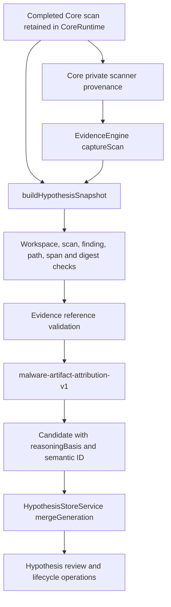

# Aqiron Hypothesis Reasoning Engine

## Purpose and scope

Hypothesis Reasoning is a Core-owned step that turns a narrow, verified set of scan observations into an explainable investigative lead. It is separate from scanner findings because findings are scanner outputs with their own identifiers, severity, and lifecycle, while a hypothesis is a proposition about how evidence may relate. Generating or reviewing a hypothesis does not rewrite a finding.

Four concepts must remain distinct:

- **Evidence facts** are observations captured and checked by Core. Evidence Engine V1 currently records source-span observations associated with native scanner findings.
- **Deterministic reasoning** is a Core rule applying an explicit predicate to snapshot-bound evidence. It describes why references support an investigative question; it does not add observations.
- **A hypothesis** is a proposed, falsifiable lead that requires review. Current output carries status `proposed` and low confidence.
- **A confirmed vulnerability** is not produced by Hypothesis Reasoning. A hypothesis status review is a reviewer lifecycle action, not controlled validation and not a `UnifiedFinding` creation operation.

This document describes the implementation in Milestone 20. It is the canonical implementation and roadmap reference; it does not describe the complete intended future engine. Evidence Engine V1 facts and storage are documented separately in [Evidence Engine V1](evidence_engine.md).

Controlled Validation is a separate, Core-owned capability and is not implemented or available. It does not change deterministic reasoning or the existing hypothesis review lifecycle. See the design-only [Controlled Validation architecture and threat model](controlled_validation.md). The production AI synthesis gate remains closed.

## Current implementation — Milestone 20

### Rule and admission conditions

`generateDeterministicHypotheses()` currently supports one rule: `malware-artifact-attribution-v1`. It emits the question “Does the malware indicator reported by … belong to the mobile artifact associated with …?” only when all of the following are present in one `HypothesisSnapshot` and pass `validateEvidenceReference()`:

1. The source and target scanner findings referenced by a `malware-to-artifact` correlation.
2. A current `source-span` reference for each finding.
3. A current `finding` reference for each finding.
4. The current `relationship` reference for that correlation.

The rule skips findings whose `sourceTool` is `AI Analysis`. It does not accept a generic finding, a relationship alone, or stale or malformed evidence as sufficient. When evidence is insufficient, generation returns no candidate for this rule; the runtime reports `no-evidence`, `no-supported-rule`, or evidence diagnostics according to which stage lacked usable evidence.

Each generated candidate contains `reasoningBasis`:

```ts
{
  engine: 'core-deterministic',
  ruleId: 'malware-artifact-attribution-v1',
  evidenceIds: string[],
  limitations: string[]
}
```

The IDs identify exactly the candidate's `evidence` references. Persistence validation requires both lists to contain unique IDs and to match exactly independent of order. Limitations state that the correlation does not establish artifact attribution, execution, reachability, exploitability, or vulnerability status. Existing persisted records without `reasoningBasis` remain readable for compatibility.

### Semantic candidate identity

Candidate IDs use a SHA-256-derived key built from the lexical workspace root, normalized question, asset path, and sorted semantic evidence keys. Finding keys use source tool, rule, relative path, line range, and span content hash. Source-span keys use relative path, line range, and span hash. These keys deliberately exclude random canonical `ev1_` observation IDs and scan-local finding IDs so unchanged semantic evidence can retain the same hypothesis ID across scans.

Relationship semantic keys include relationship type and semantic endpoint keys. Direction is preserved by default. The correlation engine constructs `same-file` from an unordered pair loop, so only `same-file` normalizes endpoint order. `dependency-to-source`, `secret-to-dependency`, `malware-to-artifact`, and `attack-path` encode source and target roles and remain directional. `duplicate-of` exists in the relationship type but the current correlation engine does not construct it; it is not treated as a confirmed symmetric type by the semantic-key function.

The candidate ID currently excludes both the reasoning rule ID and a separate rule-version value. This is acceptable for the current single-rule implementation, but it is a constraint on multi-rule expansion. Before multiple rules can generate candidates, the identity contract must include rule identity/version or define an explicit cross-rule deduplication policy.

The identity is scoped to the current semantic inputs, not a universal identity guarantee. It does not currently include a separate reasoning-rule version field in the hash; the rule ID is recorded in `reasoningBasis`. Changes to rule semantics therefore require deliberate identity/versioning design in a future rule framework.

### Confidence and limits

The rule's factors describe evidence conditions, not probability. It records verified source spans, whether the two findings have distinct `sourceTool` values, the heuristic relationship, current snapshot freshness, absence of explicit contrary references, and unknown execution preconditions. The relationship is explicitly classified as heuristic. Confidence is low; high is not assigned by the current policy. The generic band function can return moderate only when multiple source families and an explicit relationship are both represented, a combination this current rule does not produce.

The `none-observed` contradiction factor means the snapshot has no explicit contradictory reference. It is not evidence that contradictory facts do not exist. There is no explicit contradiction model in the current deterministic rule.

## Architecture and data flow



1. **Core scan results:** Core retains completed scan results in its runtime, including findings, correlation relationships, and private native scanner provenance. Hypothesis generation requires a completed scan whose normalized workspace matches the request. It does not launch another scan.
2. **Evidence Engine observations:** After scanning, Core passes native provenance to `EvidenceEngine.captureScan()`. That service validates provenance and rereads bounded source bytes before appending source-span observations to `.aqiron-security/evidence.json`.
3. **Snapshot construction:** `buildHypothesisSnapshot()` accepts only findings paired with Core scan-time provenance that agrees on finding ID, source tool, rule, range, and relative path. It validates physical workspace containment, rejects symlinks, rereads bounded bytes, and checks both scan-time file and span digests. It resolves Evidence Engine observations by physical workspace, scan ID, and finding ID. One exact observation is rechecked; duplicate or contradictory associations exclude the finding. If no canonical observation is associated, a legacy `span:` reference is retained only when the current file still matches the original scanner provenance.
4. **Reference validation:** `validateEvidenceReference()` binds each reference to an exact ID and kind in the same snapshot, checks fields against the recorded reference, validates safe paths and line coordinates, and confirms the referenced finding or relationship exists in that snapshot. A canonical evidence reference must have valid canonical freshness markers. Only current references pass.
5. **Deterministic reasoning:** The rule iterates snapshot relationships, admits only `malware-to-artifact`, resolves both endpoint findings, and requires all five current references (two findings, two spans, one relationship).
6. **Candidate generation:** Core produces bounded deterministic text, factors, assumptions, a verification step, `reasoningBasis`, and a semantic ID. It does not produce a confirmed finding.
7. **Persistence:** `HypothesisStoreService.mergeGeneration()` serializes per-workspace updates, rejects an older scan snapshot, merges candidates by ID, validates the resulting store, and writes using the store's locked atomic-replacement/recovery flow. It retains up to 20 snapshot metadata records and 500 hypotheses.
8. **Review:** Core review operations apply the lifecycle transition to a stored hypothesis and record one `review` object containing the latest action, time, and optional note/reference IDs. This is not a multi-event append-only audit log.

## Evidence and provenance invariants

- **Core ownership:** The protocol caller does not supply evidence IDs, scanner provenance, hashes, or canonical observation contents. Core obtains provenance from its scan path and owns the Evidence Engine association.
- **Workspace and scan association:** Evidence observations are selected by physical workspace identity, scan ID, and originating finding ID. Snapshot generation verifies the full locator and digest tuple. A record from another workspace or scan cannot be selected as current evidence.
- **Snapshot binding:** A candidate reference must exactly match an entry in the snapshot that produced it. A caller-created or stale reference cannot become valid just by copying its fields into a candidate.
- **Source freshness:** The evidence engine verifies persisted observations against current bounded source reads. Snapshot construction independently checks source content against the scanner-time digests. Store listing rechecks persisted hypothesis source spans and marks changed/unavailable references stale.
- **Reference identity:** Canonical source references use Core-generated `ev1_` IDs plus explicit origin/freshness markers. Legacy source-span references use the `span:` form. Finding and relationship references use snapshot-local IDs. Markerless old legacy records remain supported; inconsistent canonical markers are rejected.
- **Reasoning trace:** When present, `reasoningBasis.evidenceIds` must exactly match the hypothesis's evidence IDs, including uniqueness in both collections. This makes the rule's declared evidence set inspectable and prevents omitted, added, or duplicated references from passing persistence validation.
- **Fail closed:** Missing scanner provenance, unreadable or oversized sources, changed hashes, unsafe paths, invalid spans, duplicate/ambiguous canonical associations, malformed references, and unavailable freshness cannot support a generated candidate. Generation diagnostics report exclusions where applicable.
- **Absence is not evidence of absence:** No contrary reference in a snapshot means only that the current pipeline did not provide one. It cannot establish that a condition is absent or false.

Evidence Engine V1 persists immutable source observations, but this does not make the workspace filesystem a cryptographic trust anchor. Same-user workspace tampering, filesystem races, network filesystem semantics, and tamper-proof signatures are outside the current guarantee. See the [Evidence Engine V1 trust and persistence details](evidence_engine.md).

## Confidence and uncertainty

Current confidence is an ordinal band with typed factors and policy version 1. It is not a probability, severity, CVSS score, or proof. The current attribution rule always yields `low`: a verified source span establishes a checked source location, distinct source tools indicate source-family diversity, and a correlation relationship offers a heuristic association. The correlation engine's weight and reason text do not calibrate confidence and are not treated as proof. Unknown preconditions stay unknown. Explicit contradictory factors, if provided to the generic band function, prevent an increase in the band; the current rule does not produce explicit contrary evidence.

Future rules should expose bounded, reviewable rationale and limitations, identify the exact evidence references behind each factor, state what evidence is missing, and distinguish contradictory evidence from an unobserved signal. Avoid hidden reasoning traces and confidence values that imply statistical calibration without supporting data.

## Hypothesis lifecycle and persistence

The current status type includes `proposed`, `investigating`, `validated`, `rejected`, `dismissed`, `stale`, and `unsubstantiated`. Current transitions are:

| Current status | Allowed review actions and result |
| --- | --- |
| `proposed` | `investigate` → `investigating`; `validate` → `validated`; `reject` → `rejected`; `dismiss` → `dismissed` |
| `investigating` | `validate` → `validated`; `reject` → `rejected`; `dismiss` → `dismissed` |
| `dismissed` | `reopen` → `proposed` |
| `validated`, `rejected`, `stale`, `unsubstantiated` | No transition in the current transition table |

The review operation refuses stale or unavailable evidence. `validate` requires at least one selected current supporting evidence reference; both `validate` and `reject` require current source-span provenance. These lifecycle actions are reviewer assertions within the stored hypothesis workflow. They do not execute controlled validation, create a `UnifiedFinding`, or independently prove exploitability.

The store is `.aqiron-security/hypotheses.json`, schema version 1, bounded to 5 MB, 500 hypotheses, and 20 snapshot metadata entries. It uses per-workspace locking, temporary sibling files, backup/rename recovery, and fails closed on invalid or ambiguous store state. Its committed store generation is monotonic. This is a mergeable current-state store, not an append-only history of every generated version or review event.

On regeneration, a candidate with the same ID retains the original `createdAt`. Matching `investigating` or `dismissed` records receive regenerated candidate content while their status and one review object are retained. Matching `validated` and `rejected` records are returned unchanged on an ID collision; regenerated content cannot silently replace the reviewed historical record. When a new snapshot no longer produces an active `proposed`, `investigating`, or `dismissed` hypothesis, the old record is marked `stale`. Evidence freshness checks can also mark references stale. A validated or rejected status remains historical when evidence becomes stale, while its evidence references and `evidenceFreshness` are updated to show the changed provenance.

Legacy store records without `reasoningBasis` and some legacy records without current source-span provenance remain readable. When provenance cannot be established, Core marks it unavailable/stale and will not accept a validate/reject review as if the evidence were current.

## Current limitations

Milestone 20 does not implement:

- A broad multi-rule reasoning framework or rule registration API.
- General business-logic vulnerability inference or generic attack-path reasoning.
- Explicit contradiction/counter-evidence modeling in the current rule.
- General multi-source, cross-component, or dependency reasoning beyond the narrow candidate relation.
- Controlled Validation, reproducible security testing, or exploitability checks.
- Human research notes, evidence requests, authored hypotheses, roles, or an append-only review event history.
- Automatic creation or mutation of confirmed scanner findings from hypotheses.
- Production AI hypothesis synthesis. Core has AI preparation/execution-related contracts and internal code, but the production synthesis executor remains behind the fixed closed gate. Preview/contracts do not authorize provider execution.

Evidence Engine V1 is also limited to native-scanner source spans; it does not collect network/API, runtime, dependency, service, or artifact evidence. See its [implemented scope and deferred collectors](evidence_engine.md#implemented-v1-and-limits).

## Future roadmap — planned, not implemented

The items below are development areas, not delivery commitments. Each requires its own acceptance criteria; security/design review is called out where the change affects trust, validation, or external execution.

### 1. Reasoning Rule Expansion

**Status: Implemented narrowly; expansion planned.** The current implementation has one direct deterministic rule and a rule ID in `reasoningBasis`. A future rule registry/execution contract should define required evidence kinds, bounded input/output, stable rule IDs and versions, explicit skip/reject diagnostics, and deterministic ordering. Reproducibility should ensure that the same snapshot and rule version produce identical semantic candidate content and IDs, excluding operational timestamps and store-managed lifecycle metadata.

### 2. Multi-Source Reasoning

**Status: Deferred; proposed.** Future rules may correlate findings with additional Core-owned evidence sources, cross-component/dependency context, and multi-step attack-path propositions. Every edge should preserve direction and derivation provenance where roles matter; symmetric normalization should be limited to relationships whose producer contract proves symmetry. Multi-step claims should identify each edge and its source, and heuristic graph associations must not be presented as verified reachability.

### 3. Contradiction and Counter-Evidence

**Status: Not implemented; proposed.** Define explicit facts that support or refute a proposition, retain each fact's provenance and freshness, and represent incomplete/conflicting observations separately. A missing observation must remain “unknown,” not become a negative fact. Rules and reviewers need a policy for conflicts, stale contrary facts, and evidence that is insufficient to decide.

### 4. Confidence and Explainability

**Status: Basic factors implemented; expansion planned.** The current bands and factor list are coarse. Future work should link each factor to exact supporting/refuting evidence IDs, expose sufficiency and uncertainty explicitly, explain why a rule fired or declined to fire, and version policy changes. Any calibrated or numeric confidence requires adjudicated data and validation; heuristic weights alone are not calibration.

### 5. Hypothesis Relationships and Deduplication

**Status: Candidate-level deterministic deduplication implemented; broader model deferred.** Current generation deduplicates candidates sharing an ID. It does not build a general related-hypothesis graph or classify duplicates/supersession. Future work should define related, duplicate, and superseding relations, shared-evidence semantics, and stable identity across scans and rule-version changes without merging distinct claims or erasing reviewer history.

### 6. Human-Assisted Reasoning

**Status: Basic review lifecycle implemented; research workflows deferred.** Current review supports a status action, optional short note, and evidence reference IDs, storing one latest review object. Future work may add reviewer annotations, requests for more evidence, research notes, and human-authored hypotheses. Human conclusions and machine-generated suggestions should remain separately attributed and never be silently merged into one claim.

### 7. Controlled Validation Integration

**Status: Deferred; requires separate security/design review.** Controlled Validation is a separate future capability, not a mode of deterministic reasoning and not currently available. Any future integration must bind the exact hypothesis ID and evidence snapshot to an approved procedure, scope/authorization, environment, and observed results. Validation outcomes must be reproducible and auditable, distinguish “not reproduced” from “false,” and be reviewed before a separately authorized workflow creates or links a confirmed finding. No rule or AI prose may itself perform that promotion.

## Security invariants

- Core remains authoritative for scan provenance, evidence IDs, snapshot construction, reference validation, and persistence.
- Reasoning consumes evidence; it cannot manufacture evidence or accept caller-controlled provenance.
- Every generated candidate is traceable to its rule ID and exact snapshot evidence IDs.
- Evidence must be current and bound to the expected workspace, scan, finding, and snapshot; malformed, ambiguous, stale, or unavailable evidence fails closed.
- AI-generated suspicion, confidence, or prose cannot establish vulnerability status.
- Reviewed `validated` and `rejected` records cannot be silently rewritten by colliding regenerated candidates.
- Hypotheses do not mutate existing scanner findings. Current hypothesis generation and review do not create or link UnifiedFinding records. Any future promotion must be implemented as a separate, explicitly authorized and validated workflow with its own acceptance criteria.
- Controlled Validation remains separate and unavailable until its own security and design review.
- Production hypothesis AI synthesis remains disabled by `PRODUCTION_HYPOTHESIS_AI_EXECUTION_ENABLED = false` in Core. No ordinary configuration switch, protocol field, environment variable, CLI flag, or alternate route may bypass the fixed gate.

## Relationship to other documentation

- [Evidence Engine V1](evidence_engine.md) is the canonical source-span facts, ownership, freshness, storage, and trust-boundary reference.
- [Hypothesis Engine design and repository audit](hypothesis-engine-design.md) preserves the historical proposal and implementation audit trail. Its proposal sections are not a statement that proposed capabilities exist; this document is canonical for current reasoning behavior and future roadmap.
- [Historical Evidence Engine architecture](architecture/evidence-engine.md) is explicitly marked as superseded by the canonical Evidence Engine V1 reference.
